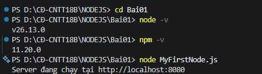
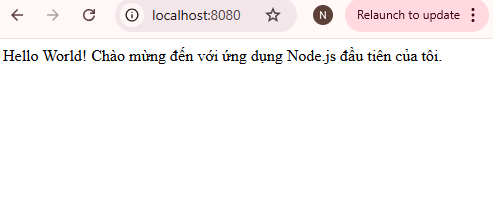

# BÀI 1: CÀI ĐẶT MÔI TRƯỜNG & KHỞI TẠO ỨNG DỤNG NODE.JS ĐẦU TIÊN

## 1. Thông Tin Sinh Viên
- **Họ và tên:** Hồ Sỹ Ngọc Hải
- **Mã sinh viên:** CDCNTT18B10
- **Lớp:** CĐ-CNTT18B
- **Môn học:** Lập trình Node.js (Bài 1 — Cài đặt môi trường và làm quen với Node.js)

---

## 2. Mục Tiêu & Yêu Cầu Bài Thực Hành
1. Cài đặt và kiểm tra môi trường Node.js và công cụ quản lý gói npm trên máy tính.
2. Xây dựng chương trình Web Server đầu tiên sử dụng module tích hợp sẵn `http` trong Node.js.
3. Thiết lập server lắng nghe trên cổng `8080` (`http://localhost:8080`).
4. Cấu hình header phản hồi với mã trạng thái HTTP 200 và bảng mã `charset=utf-8` để hiển thị tiếng Việt chính xác.
5. Gửi thông điệp chào mừng: `"Hello World! Chào mừng đến với ứng dụng Node.js đầu tiên của tôi."`.
6. Hiển thị thông báo trạng thái server đang hoạt động trên Terminal.
7. Truy cập trình duyệt web để kiểm tra kết quả trả về từ server.

---

## 3. Cấu Trúc Thư Mục
```text
Bai01/
├── anh1-bai1.png      # Ảnh Terminal kiểm tra phiên bản Node, npm và thực thi chạy server
├── anh2-bai1.png      # Ảnh Trình duyệt truy cập localhost:8080 hiển thị thông điệp phản hồi
├── hello.js           # Mã nguồn khởi tạo Web Server lắng nghe cổng 8080
├── MyFirstNode.js     # Mã nguồn đồng bộ phục vụ lệnh chạy node MyFirstNode.js
└── README.md          # Tài liệu hướng dẫn chi tiết và kết quả thực hiện
```

---

## 4. Hướng Dẫn Thực Hiện

### Bước 1: Mở Terminal trong Visual Studio Code
Mở thư mục dự án `D:\CĐ-CNTT18B\NODEJS` trong Visual Studio Code và mở Terminal tích hợp (`Ctrl + \``).

### Bước 2: Di chuyển vào thư mục bài tập Bai01
```powershell
cd Bai01
```

### Bước 3: Kiểm tra phiên bản Node.js và npm
```powershell
node -v
npm -v
```

### Bước 4: Khởi động Web Server
Chạy tập tin mã nguồn bằng lệnh:
```powershell
node hello.js
# hoặc
node MyFirstNode.js
```

### Bước 5: Kiểm tra kết quả trên trình duyệt
Mở trình duyệt web bất kỳ (Chrome, Edge, Firefox) và truy cập vào đường dẫn:
```text
http://localhost:8080
```

---

## 5. Hình Ảnh Minh Họa Kết Quả Thực Tế

### Ảnh 1: Kiểm tra phiên bản môi trường & Khởi động Server
Terminal kiểm tra phiên bản Node.js (`v26.13.0`), phiên bản npm (`11.20.0`) và khởi chạy server thành công tại cổng 8080:



---

### Ảnh 2: Kết quả hiển thị trên trình duyệt web
Trình duyệt truy cập địa chỉ `http://localhost:8080` nhận được nội dung phản hồi từ Web Server Node.js:



---

## 6. Kết Quả Hiển Thị Chi Tiết Trên Terminal

```text
PS D:\CĐ-CNTT18B\NODEJS> cd Bai01
PS D:\CĐ-CNTT18B\NODEJS\Bai01> node -v
v26.13.0
PS D:\CĐ-CNTT18B\NODEJS\Bai01> npm -v
11.20.0
PS D:\CĐ-CNTT18B\NODEJS\Bai01> node MyFirstNode.js
Server đang chạy tại http://localhost:8080
```

---

## 7. Giải Thích Mã Nguồn & Kiến Thức Cốt Lõi

```javascript
var http = require('http');

http.createServer(function (req, res) {
  res.writeHead(200, {'Content-Type': 'text/html; charset=utf-8'});
  res.end('Hello World! Chào mừng đến với ứng dụng Node.js đầu tiên của tôi.');
}).listen(8080);

console.log('Server đang chạy tại http://localhost:8080');
```

| Cú Pháp / Phương Thức | Giải Thích Chức Năng |
| :--- | :--- |
| `require('http')` | Nạp module cốt lõi `http` có sẵn trong Node.js để làm việc với giao thức HTTP mà không cần cài đặt thêm thư viện ngoài. |
| `http.createServer(callback)` | Khởi tạo một đối tượng Web Server. Hàm callback nhận vào 2 tham số: `req` (request từ client) và `res` (response gửi về client). |
| `res.writeHead(200, headers)` | Thiết lập HTTP status code `200 OK` cùng header `Content-Type: text/html; charset=utf-8` giúp trình duyệt hiển thị đúng chuẩn tiếng Việt. |
| `res.end(data)` | Gửi dữ liệu chuỗi nội dung phản hồi về trình duyệt và kết thúc phiên truyền dữ liệu HTTP. |
| `.listen(8080)` | Đặt Web Server vào trạng thái lắng nghe các yêu cầu kết nối gửi đến cổng cổng `8080`. |
