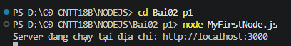
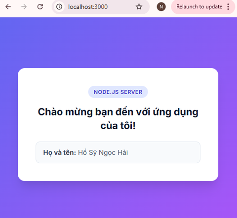

# BÀI 2 - PHẦN 1: XÂY DỰNG WEB SERVER VÀ THIẾT KẾ GIAO DIỆN HTML/CSS (PORT 3000)

## 1. Thông Tin Sinh Viên
- **Họ và tên:** Hồ Sỹ Ngọc Hải
- **Mã sinh viên:** CDCNTT18B10
- **Lớp:** CĐ-CNTT18B
- **Môn học:** Lập trình Node.js (Bài 2 — Xây dựng Web Server cơ bản và hiển thị HTML, Phần 1)

---

## 2. Mục Tiêu & Yêu Cầu Bài Thực Hành
1. Xây dựng ứng dụng Web Server bằng Node.js sử dụng module `http`.
2. Thiết lập server lắng nghe trên cổng `3000` (`http://localhost:3000`).
3. Cấu hình trả về nội dung HTML đầy đủ (`<!DOCTYPE html>`) với bộ mã `charset=utf-8`.
4. Thiết kế giao diện hiện đại bằng CSS nhúng trực tiếp:
   - Sử dụng Google Fonts `Inter`.
   - Nền trang chuyển sắc gradient mềm mại (`#6366f1` đến `#a855f7`).
   - Khung thẻ (Card) trung tâm đổ bóng, hiệu ứng chuyển động `fadeIn`.
   - Huy hiệu `NODE.JS SERVER` bo góc nổi bật.
   - Khung chứa thông tin cá nhân: **Họ và tên: Hồ Sỹ Ngọc Hải**.
5. Hiển thị thông báo trạng thái server đang chạy trên Terminal.
6. Mở trình duyệt web và kiểm tra kết quả hiển thị trên `http://localhost:3000`.

---

## 3. Cấu Trúc Thư Mục
```text
Bai02-p1/
├── anh1-p1.png        # Ảnh Terminal thực thi lệnh khởi chạy server cổng 3000
├── anh2-p1.png        # Ảnh Trình duyệt hiển thị giao diện Card với thông tin Họ và tên
├── MyFirstNode.js     # Mã nguồn Web Server phục vụ cấu trúc HTML/CSS giao diện
└── README.md          # Tài liệu hướng dẫn chi tiết và kết quả thực hiện
```

---

## 4. Hướng Dẫn Thực Hiện

### Bước 1: Mở Terminal trong Visual Studio Code
Mở thư mục dự án `D:\CĐ-CNTT18B\NODEJS` trong Visual Studio Code và mở Terminal tích hợp (`Ctrl + \``).

### Bước 2: Di chuyển vào thư mục bài tập Bai02-p1
```powershell
cd Bai02-p1
```

### Bước 3: Khởi động Web Server
Chạy tập tin `MyFirstNode.js` bằng lệnh:
```powershell
node MyFirstNode.js
```

### Bước 4: Kiểm tra kết quả trên trình duyệt
Mở trình duyệt web bất kỳ và truy cập vào đường dẫn:
```text
http://localhost:3000
```

---

## 5. Hình Ảnh Minh Họa Kết Quả Thực Tế

### Ảnh 1: Khởi động Web Server trên Terminal
Terminal ghi nhận lệnh di chuyển vào thư mục `Bai02-p1`, khởi chạy thành công `MyFirstNode.js` và lắng nghe tại cổng 3000:



---

### Ảnh 2: Giao diện Card HTML/CSS trên trình duyệt web
Trình duyệt truy cập `http://localhost:3000` hiển thị giao diện Card hiện đại với hiệu ứng gradient và thông tin cá nhân:



---

## 6. Kết Quả Hiển Thị Chi Tiết Trên Terminal

```text
PS D:\CĐ-CNTT18B\NODEJS> cd Bai02-p1
PS D:\CĐ-CNTT18B\NODEJS\Bai02-p1> node MyFirstNode.js
Server đang chạy tại địa chỉ: http://localhost:3000
```

---

## 7. Giải Thích Cấu Trúc Mã Nguồn

```javascript
const http = require('http');

const PORT = 3000;

const server = http.createServer((req, res) => {
  res.writeHead(200, { 'Content-Type': 'text/html; charset=utf-8' });

  res.write(`
    <!DOCTYPE html>
    <html lang="vi">
    <!-- Cấu trúc HTML & CSS Card thông tin -->
    ...
  `);

  res.end();
});

server.listen(PORT, () => {
  console.log(`Server đang chạy tại địa chỉ: http://localhost:${PORT}`);
});
```

| Thành Phần Kỹ Thuật | Vai Trò & Tác Dụng |
| :--- | :--- |
| `const PORT = 3000;` | Khai báo hằng số cổng kết nối chuẩn giúp dễ dàng thay đổi cấu hình cổng khi cần thiết. |
| `res.writeHead(200, ...)` | Khai báo mã phản hồi HTTP thành công và định dạng dữ liệu là văn bản HTML UTF-8. |
| `res.write(...)` | Gửi từng phần dữ liệu HTML giao diện về cho trình duyệt kết xuất đồ họa. |
| `res.end()` | Báo hiệu cho trình duyệt biết toàn bộ gói tin HTML đã được gửi xong và sẵn sàng render. |
| `server.listen(PORT, ...)` | Kích hoạt tiến trình Node.js duy trì trạng thái lắng nghe trên cổng 3000 và in log ra console khi sẵn sàng. |
