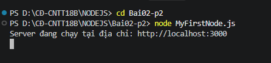
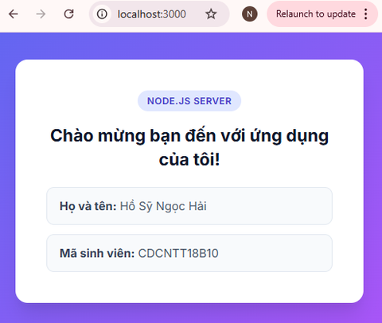

# BÀI 2 - PHẦN 2: NÂNG CẤP GIAO DIỆN WEB SERVER VÀ BỔ SUNG THÔNG TIN SINH VIÊN (PORT 3000)

## 1. Thông Tin Sinh Viên
- **Họ và tên:** Hồ Sỹ Ngọc Hải
- **Mã sinh viên:** CDCNTT18B10
- **Lớp:** CĐ-CNTT18B
- **Môn học:** Lập trình Node.js (Bài 2 — Nâng cấp giao diện Web Server, Phần 2)

---

## 2. Mục Tiêu & Yêu Cầu Bài Thực Hành
1. Kế thừa và phát triển ứng dụng Web Server Node.js từ Bài 2 - Phần 1.
2. Nâng cấp giao diện hiển thị: bổ sung thêm khung thông tin **Mã sinh viên** bên cạnh trường **Họ và tên**.
3. Cấu trúc thông tin sinh viên hiển thị đầy đủ và rõ ràng:
   - **Họ và tên:** Hồ Sỹ Ngọc Hải
   - **Mã sinh viên:** CDCNTT18B10
4. Sử dụng bố cục Flexbox hiện đại với thuộc tính `gap: 12px` phân tách các khung thông tin (`.info-item`), hỗ trợ hiệu ứng tương tác `hover` đổi màu nền và viền.
5. Duy trì cấu hình server hoạt động trên cổng `3000` (`http://localhost:3000`).
6. Kiểm tra trực quan kết quả giao diện nâng cấp trên trình duyệt web.

---

## 3. Cấu Trúc Thư Mục
```text
Bai02-p2/
├── anh1-p2.png        # Ảnh Terminal thực thi lệnh khởi chạy server cổng 3000
├── anh2-p2.png        # Ảnh Trình duyệt hiển thị giao diện Card đầy đủ Họ tên & MSSV
├── MyFirstNode.js     # Mã nguồn Web Server nâng cấp giao diện HTML/CSS
└── README.md          # Tài liệu hướng dẫn chi tiết và kết quả thực hiện
```

---

## 4. Hướng Dẫn Thực Hiện

### Bước 1: Mở Terminal trong Visual Studio Code
Mở thư mục dự án `D:\CĐ-CNTT18B\NODEJS` trong Visual Studio Code và mở Terminal tích hợp (`Ctrl + \``).

### Bước 2: Di chuyển vào thư mục bài tập Bai02-p2
```powershell
cd Bai02-p2
```

### Bước 3: Khởi động Web Server
Chạy tập tin `MyFirstNode.js` bằng lệnh:
```powershell
node MyFirstNode.js
```

### Bước 4: Kiểm tra kết quả trên trình duyệt
Mở trình duyệt web bất kỳ và truy cập vào đường dẫn:
```text
http://localhost:3000
```

---

## 5. Hình Ảnh Minh Họa Kết Quả Thực Tế

### Ảnh 1: Khởi động Web Server trên Terminal
Terminal ghi nhận lệnh di chuyển vào thư mục `Bai02-p2`, chạy tập tin `MyFirstNode.js` và xác nhận server đang lắng nghe tại cổng 3000:



---

### Ảnh 2: Giao diện Card HTML/CSS nâng cấp trên trình duyệt web
Trình duyệt truy cập `http://localhost:3000` hiển thị giao diện Card hoàn thiện với 2 khung thông tin: **Họ và tên** và **Mã sinh viên**:



---

## 6. Kết Quả Hiển Thị Chi Tiết Trên Terminal

```text
PS D:\CĐ-CNTT18B\NODEJS> cd Bai02-p2
PS D:\CĐ-CNTT18B\NODEJS\Bai02-p2> node MyFirstNode.js
Server đang chạy tại địa chỉ: http://localhost:3000
```

---

## 7. So Sánh Điểm Nâng Cấp Giữa Phần 1 Và Phần 2

| Tiêu Chí | Bài 2 - Phần 1 (`Bai02-p1`) | Bài 2 - Phần 2 (`Bai02-p2`) |
| :--- | :--- | :--- |
| **Số lượng khung thông tin** | 1 khung thông tin duy nhất | 2 khung thông tin độc lập |
| **Thông tin hiển thị** | Họ và tên: Hồ Sỹ Ngọc Hải | Họ và tên: Hồ Sỹ Ngọc Hải<br>Mã sinh viên: CDCNTT18B10 |
| **Bố cục Flexbox** | Cơ bản | Tối ưu với `gap: 12px`, hiệu ứng `.info-item:hover` tinh tế |
| **Trải nghiệm giao diện** | Khởi đầu tạo hình Card | Hoàn thiện đầy đủ danh tính sinh viên thực hiện bài làm |
