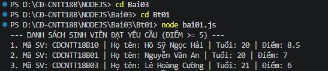

# BÀI TẬP 1: QUẢN LÝ THÔNG TIN SINH VIÊN BẰNG JAVASCRIPT ES6

## 1. Thông Tin Sinh Viên
- **Họ và tên:** Hồ Sỹ Ngọc Hải
- **Mã sinh viên:** CDCNTT18B10
- **Lớp:** CĐ-CNTT18B
- **Môn học:** Lập trình Node.js (Bài thực hành số 03)

---

## 2. Mục Tiêu & Yêu Cầu Bài Thực Hành
Tạo tập tin `bai01.js` thực hiện các yêu cầu:
1. Khai báo danh sách 5 sinh viên, mỗi sinh viên gồm các thuộc tính: mã sinh viên, họ tên, tuổi và điểm.
2. Sử dụng `class`, `constructor` của chuẩn ES6 để biểu diễn đối tượng sinh viên.
3. Sử dụng hàm mũi tên (`arrow function`) kết hợp phương thức `filter()` để lọc danh sách sinh viên có điểm từ 5 trở lên ($\ge 5$).
4. Hiển thị danh sách sinh viên đạt yêu cầu ra màn hình bằng lệnh `console.log()`.

---

## 3. Cấu Trúc Thư Mục
```text
Bt01/
├── bai01.js       # Tập tin mã nguồn JavaScript ES6
├── anhbt1.png     # Ảnh chụp kết quả thực thi trên Terminal
└── README.md      # Tài liệu mô tả các lệnh thực hiện và kết quả
```

---

## 4. Mô Tả Các Bước & Lệnh Thực Hiện

### Bước 1: Mở Terminal trong Visual Studio Code
Mở VS Code tại thư mục dự án `D:\CĐ-CNTT18B\NODEJS`, sau đó mở Terminal tích hợp (`Ctrl + \``).

### Bước 2: Di chuyển vào thư mục bài tập Bt01
Thực hiện các lệnh điều hướng thư mục:
```powershell
cd Bai03\Bt01
```

### Bước 3: Thực thi chương trình
Chạy tập tin `bai01.js` bằng môi trường Node.js:
```powershell
node bai01.js
```

---

## 5. Ảnh Chạy Các Bước & Kết Quả Cuối Cùng

Dưới đây là hình ảnh chụp lại toàn bộ quá trình gõ lệnh và kết quả hiển thị trên Terminal:



---

## 6. Kết Quả Hiển Thị Chi Tiết Trên Terminal
```text
PS D:\CĐ-CNTT18B\NODEJS> cd Bai03
PS D:\CĐ-CNTT18B\NODEJS\Bai03> cd Bt01
PS D:\CĐ-CNTT18B\NODEJS\Bai03\Bt01> node bai01.js
--- DANH SÁCH SINH VIÊN ĐẠT YÊU CẦU (ĐIỂM >= 5) ---
1. Mã SV: CDCNTT18B10 | Họ tên: Hồ Sỹ Ngọc Hải | Tuổi: 20 | Điểm: 8.5
2. Mã SV: CDCNTT18B01 | Họ tên: Nguyễn Văn An | Tuổi: 20 | Điểm: 7
3. Mã SV: CDCNTT18B03 | Họ tên: Lê Hoàng Cường | Tuổi: 21 | Điểm: 6
```

---

## 7. Giải Thích Mã Nguồn
- **Class & Constructor ES6:** Lớp `SinhVien` đóng gói dữ liệu sinh viên bao gồm mã, họ tên, tuổi và điểm số, kèm phương thức `hienThi()` để định dạng chuỗi thông tin.
- **Khởi tạo mảng dữ liệu:** Mảng `danhSachSinhVien` chứa 5 đối tượng sinh viên với các mức điểm khác nhau (trong đó có sinh viên đạt và sinh viên chưa đạt).
- **Arrow Function Filter:** `const sinhVienDatYeuCau = danhSachSinhVien.filter(sv => sv.diem >= 5);` giúp lọc nhanh chóng, ngắn gọn các sinh viên thỏa mãn điều kiện theo chuẩn cú pháp ES6.
