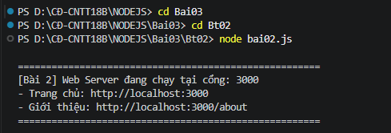
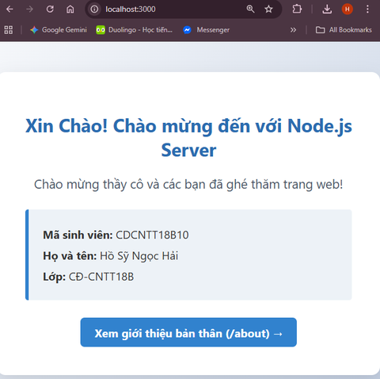
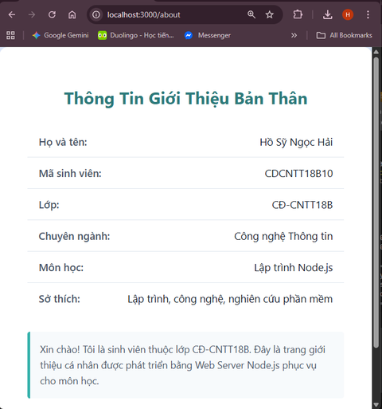
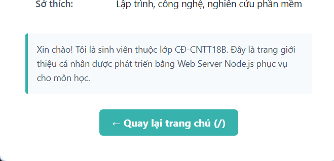

# BÀI TẬP 2: TẠO WEB SERVER VỚI NODE.JS

## 1. Thông Tin Sinh Viên
- **Họ và tên:** Hồ Sỹ Ngọc Hải
- **Mã sinh viên:** CDCNTT18B10
- **Lớp:** CĐ-CNTT18B
- **Môn học:** Lập trình Node.js (Bài thực hành số 03)

---

## 2. Mục Tiêu & Yêu Cầu Bài Thực Hành
Tạo tập tin `bai02.js` thực hiện các yêu cầu:
1. Sử dụng module lõi `http` của Node.js để tạo Web Server lắng nghe tại cổng `3000`.
2. Khi người dùng truy cập đường dẫn trang chủ `/`, hiển thị lời chào và mã sinh viên.
3. Khi người dùng truy cập đường dẫn `/about`, hiển thị thông tin giới thiệu bản thân chi tiết.
4. Khi người dùng truy cập các đường dẫn không tồn tại, trả về mã trạng thái HTTP `404 Not Found`.

---

## 3. Cấu Trúc Thư Mục
```text
Bt02/
├── bai02.js       # Tập tin mã nguồn tạo Web Server
├── anh1bt2.png    # Ảnh Terminal chạy lệnh khởi động server
├── anh2bt2.png    # Ảnh Trình duyệt truy cập trang chủ http://localhost:3000
├── anh3bt2.png    # Ảnh Trình duyệt truy cập trang giới thiệu http://localhost:3000/about
├── anh4bt2.png    # Ảnh Trình duyệt hiển thị chi tiết phần giới thiệu và nút quay lại
└── README.md      # Tài liệu mô tả các lệnh thực hiện và kết quả
```

---

## 4. Mô Tả Các Bước & Lệnh Thực Hiện

### Bước 1: Mở Terminal trong Visual Studio Code
Mở VS Code tại thư mục dự án `D:\CĐ-CNTT18B\NODEJS`, mở Terminal tích hợp (`Ctrl + \``).

### Bước 2: Di chuyển vào thư mục bài tập Bt02
```powershell
cd Bai03\Bt02
```

### Bước 3: Khởi động Web Server
Chạy tập tin `bai02.js`:
```powershell
node bai02.js
```
Terminal sẽ hiển thị thông báo Web Server đang chạy tại cổng 3000.

### Bước 4: Kiểm tra trên trình duyệt Web
Mở trình duyệt (Google Chrome, Microsoft Edge hoặc Cốc Cốc) và truy cập các địa chỉ:
1. **Trang chủ:** [http://localhost:3000](http://localhost:3000)
2. **Trang giới thiệu bản thân:** [http://localhost:3000/about](http://localhost:3000/about)
3. **Trang kiểm tra lỗi 404:** [http://localhost:3000/duong-dan-khong-ton-tai](http://localhost:3000/duong-dan-khong-ton-tai)

---

## 5. Ảnh Chạy Các Bước & Kết Quả Cuối Cùng

### Bước 1: Khởi động Server thành công trên Terminal
Terminal ghi nhận lệnh thực thi và cổng hoạt động của máy chủ:



---

### Bước 2: Kết quả khi truy cập trang chủ (`/`)
Trình duyệt hiển thị giao diện trang chủ với lời chào, họ tên, mã sinh viên và nút liên kết sang `/about`:



---

### Bước 3: Kết quả khi truy cập trang giới thiệu (`/about`)
Trình duyệt hiển thị đầy đủ bảng thông tin cá nhân: Họ tên, Mã sinh viên, Lớp, Chuyên ngành, Môn học và Sở thích:



---

### Bước 4: Phần giới thiệu ngắn & Nút quay lại trang chủ
Cuối trang `/about` có đoạn tự giới thiệu bản thân cùng nút điều hướng quay về trang chủ (`/`):



---

## 6. Giải Thích Mã Nguồn
- **Module `http`:** Sử dụng phương thức `http.createServer((req, res) => { ... })` để xử lý yêu cầu và trả về phản hồi tương ứng.
- **Header UTF-8:** Thiết lập `res.setHeader('Content-Type', 'text/html; charset=utf-8')` để các ký tự tiếng Việt có dấu luôn hiển thị sắc nét, không bị lỗi font trên mọi trình duyệt.
- **Xử lý định tuyến (Routing):** Sử dụng câu lệnh điều kiện `if (url === '/')`, `else if (url === '/about')` và `else` để phản hồi đúng nội dung theo từng URL hoặc trả về mã lỗi HTTP 404 nếu đường dẫn không hợp lệ.
- **Cổng lắng nghe:** Server lắng nghe tại cổng `3000` thông qua `server.listen(3000, ...)`.
