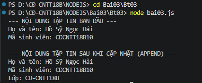

# BÀI TẬP 3: THAO TÁC TẬP TIN BẰNG FILE SYSTEM (FS MODULE)

## 1. Thông Tin Sinh Viên
- **Họ và tên:** Hồ Sỹ Ngọc Hải
- **Mã sinh viên:** CDCNTT18B10
- **Lớp:** CĐ-CNTT18B
- **Môn học:** Lập trình Node.js (Bài thực hành số 03)

---

## 2. Mục Tiêu & Yêu Cầu Bài Thực Hành
Tạo tập tin `bai03.js` sử dụng module `fs` thực hiện các yêu cầu:
1. Tạo tập tin `thongtin.txt` chứa họ tên và mã sinh viên bằng hàm `fs.writeFile()`.
2. Đọc và hiển thị nội dung tập tin lên Terminal bằng hàm `fs.readFile()`.
3. Ghi nối thêm tên lớp vào cuối tập tin bằng hàm `fs.appendFile()`.
4. Đọc lại tập tin bằng `fs.readFile()` để chứng minh nội dung đã được cập nhật thành công.

---

## 3. Lưu Ý Về Tập Tin `thongtin.txt`
> **Lưu ý:** Tập tin `thongtin.txt` **hoàn toàn không cần tạo sẵn trước trong thư mục**.
>
> Khi thực thi lệnh `node bai03.js`, chương trình sử dụng phương thức `fs.writeFile()` sẽ **tự động tạo mới** tập tin `thongtin.txt` và ghi thông tin vào. Do đó, thư mục nộp bài chỉ cần tập tin mã nguồn `bai03.js`, ảnh minh họa và tài liệu `README.md` (tập tin `.txt` thừa đã được dọn dẹp sạch sẽ).

---

## 4. Cấu Trúc Thư Mục
```text
Bt03/
├── bai03.js       # Tập tin mã nguồn thao tác với module fs
├── anhbt3.png     # Ảnh chụp kết quả các bước chạy trên Terminal
└── README.md      # Tài liệu mô tả các lệnh thực hiện và kết quả
```

---

## 5. Mô Tả Các Bước & Lệnh Thực Hiện

### Bước 1: Mở Terminal trong Visual Studio Code
Mở thư mục dự án `D:\CĐ-CNTT18B\NODEJS` trong Visual Studio Code và mở Terminal tích hợp (`Ctrl + \``).

### Bước 2: Di chuyển vào thư mục bài tập Bt03
```powershell
cd Bai03\Bt03
```

### Bước 3: Thực thi chương trình
Chạy tập tin `bai03.js`:
```powershell
node bai03.js
```

---

## 6. Ảnh Chạy Các Bước & Kết Quả Cuối Cùng

Dưới đây là hình ảnh chụp lại quá trình chạy lệnh và kết quả hiển thị trên Terminal chứng minh tập tin đã được tạo, đọc lần 1, ghi nối thêm dòng và đọc lại lần 2:



---

## 7. Kết Quả Hiển Thị Chi Tiết Trên Terminal
```text
PS D:\CĐ-CNTT18B\NODEJS> cd Bai03\Bt03
PS D:\CĐ-CNTT18B\NODEJS\Bai03\Bt03> node bai03.js
--- NỘI DUNG TẬP TIN BAN ĐẦU ---
Họ và tên: Hồ Sỹ Ngọc Hải
Mã sinh viên: CDCNTT18B10

--- NỘI DUNG TẬP TIN SAU KHI CẬP NHẬT (APPEND) ---
Họ và tên: Hồ Sỹ Ngọc Hải
Mã sinh viên: CDCNTT18B10
Lớp: CĐ-CNTT18B
```

---

## 8. Giải Thích Luồng Xử Lý Trong Mã Nguồn
1. **Khởi tạo đường dẫn:** Sử dụng `path.join(__dirname, 'thongtin.txt')` để đảm bảo đường dẫn tập tin luôn trỏ chính xác vào cùng thư mục với `bai03.js`.
2. **`fs.writeFile()`:** Tạo tập tin mới `thongtin.txt` và ghi chuỗi dữ liệu ban đầu gồm Họ tên và Mã sinh viên với bảng mã UTF-8.
3. **`fs.readFile()` lần 1:** Đọc dữ liệu vừa ghi từ tập tin và in ra màn hình Terminal để xác nhận bước tạo file thành công.
4. **`fs.appendFile()`:** Mở tập tin và nối thêm dòng dữ liệu `Lớp: CĐ-CNTT18B` vào cuối tập tin mà không làm mất dữ liệu ban đầu.
5. **`fs.readFile()` lần 2:** Đọc lại tập tin một lần nữa để chứng minh rằng tập tin hiện tại đã lưu trữ đầy đủ cả 3 thông tin: Họ tên, Mã sinh viên và Lớp học.
