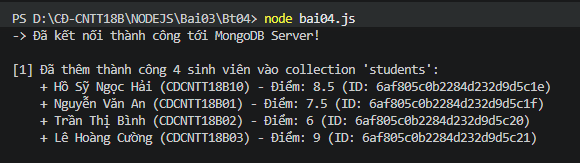
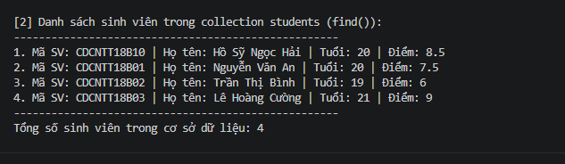
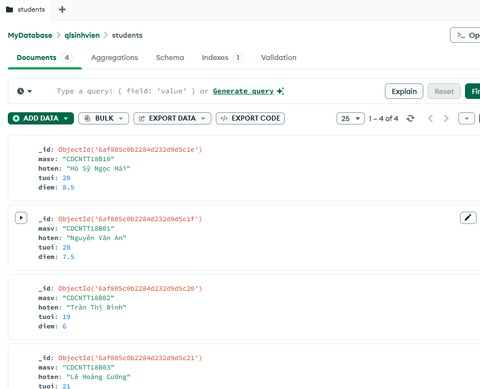

# BÀI TẬP 4: THÊM VÀ HIỂN THỊ DỮ LIỆU MONGODB (BT04)

## 1. Thông Tin Sinh Viên
- **Họ và tên:** Hồ Sỹ Ngọc Hải
- **Mã sinh viên:** CDCNTT18B10
- **Lớp:** CĐ-CNTT18B
- **Môn học:** Lập trình Node.js (Bài 3 — Module, File System và cơ sở dữ liệu)

---

## 2. Mục Tiêu & Yêu Cầu Bài Thực Hành
Tạo tập tin `bai04.js` thực hiện các yêu cầu:
1. Kết nối cơ sở dữ liệu MongoDB đang chạy trên máy cục bộ (`mongodb://localhost:27017/`).
2. Sử dụng database: **`qlsinhvien`**, collection: **`students`**.
3. Thêm ít nhất 3 sinh viên vào cơ sở dữ liệu bằng phương thức `insertMany()`, mỗi sinh viên gồm các trường: `masv`, `hoten`, `tuoi`, `diem`.
4. Sử dụng phương thức `find()` để truy vấn và hiển thị danh sách sinh viên lên Terminal.
5. Đóng kết nối MongoDB sau khi hoàn thành.
6. Thư mục được thiết lập độc lập với `package.json` và `node_modules` riêng biệt để tối ưu cho việc kiểm tra và nộp riêng bài.

---

## 3. Cấu Trúc Thư Mục
```text
Bt04/
├── bai04.js       # Tập tin mã nguồn kết nối, thêm và hiển thị dữ liệu MongoDB
├── package.json   # Cấu hình dự án và dependencies độc lập
├── node_modules/  # Thư viện MongoDB riêng biệt phục vụ nộp bài độc lập
├── anh1bt4.png    # Ảnh Terminal chạy lệnh và thêm sinh viên bằng insertMany()
├── anh2bt4.png    # Ảnh Terminal hiển thị danh sách sinh viên bằng find()
├── anh3bt4.png    # Ảnh MongoDB Compass xác nhận dữ liệu đã lưu trong MongoDB
└── README.md      # Tài liệu mô tả các lệnh thực hiện và kết quả
```

---

## 4. Mô Tả Các Bước & Lệnh Thực Hiện

### Bước 1: Khởi động dịch vụ MongoDB
Đảm bảo MongoDB Server đang chạy trên máy tính (hoặc mở ứng dụng MongoDB Compass).

### Bước 2: Mở Terminal trong Visual Studio Code
Mở VS Code tại thư mục dự án `D:\CĐ-CNTT18B\NODEJS`, mở Terminal tích hợp (`Ctrl + \``).

### Bước 3: Di chuyển vào thư mục bài tập Bt04
```powershell
cd Bai03\Bt04
```

### Bước 4: Thực thi chương trình
Chạy tập tin `bai04.js` bằng lệnh:
```powershell
node bai04.js
```

---

## 5. Ảnh Chạy Các Bước & Kết Quả Thực Tế

### Bước 1: Kết nối MongoDB & Thêm sinh viên bằng `insertMany()`
Terminal hiển thị thông báo kết nối thành công và xác nhận thêm 4 sinh viên vào collection `students`:



---

### Bước 2: Truy vấn & Hiển thị danh sách sinh viên bằng `find()`
Terminal hiển thị toàn bộ danh sách sinh viên đã lưu trong cơ sở dữ liệu:



---

### Bước 3: Dữ liệu được lưu trữ thực tế trong MongoDB (MongoDB Compass)
Giao diện MongoDB Compass xác nhận database `qlsinhvien` và collection `students` lưu trữ đầy đủ 4 documents sinh viên:



---

## 6. Kết Quả Hiển Thị Chi Tiết Trên Terminal
```text
PS D:\CĐ-CNTT18B\NODEJS\Bai03\Bt04> node bai04.js
-> Đã kết nối thành công tới MongoDB Server!

[1] Đã thêm thành công 4 sinh viên vào collection 'students':
    + Hồ Sỹ Ngọc Hải (CDCNTT18B10) - Điểm: 8.5 (ID: 6af805c0b2284d232d9d5c1e)
    + Nguyễn Văn An (CDCNTT18B01) - Điểm: 7.5 (ID: 6af805c0b2284d232d9d5c1f)
    + Trần Thị Bình (CDCNTT18B02) - Điểm: 6 (ID: 6af805c0b2284d232d9d5c20)
    + Lê Hoàng Cường (CDCNTT18B03) - Điểm: 9 (ID: 6af805c0b2284d232d9d5c21)

[2] Danh sách sinh viên trong collection students (find()):
----------------------------------------------------
1. Mã SV: CDCNTT18B10 | Họ tên: Hồ Sỹ Ngọc Hải | Tuổi: 20 | Điểm: 8.5
2. Mã SV: CDCNTT18B01 | Họ tên: Nguyễn Văn An | Tuổi: 20 | Điểm: 7.5
3. Mã SV: CDCNTT18B02 | Họ tên: Trần Thị Bình | Tuổi: 19 | Điểm: 6
4. Mã SV: CDCNTT18B03 | Họ tên: Lê Hoàng Cường | Tuổi: 21 | Điểm: 9
----------------------------------------------------
Tổng số sinh viên trong cơ sở dữ liệu: 4
```

---

## 7. Giải Thích Luồng Xử Lý Trong Mã Nguồn
1. **Khởi tạo kết nối độc lập:** Kết nối tới MongoDB qua `MongoClient` với URL `mongodb://localhost:27017/`.
2. **Quản lý Database & Collection:** Chọn database `qlsinhvien` và collection `students`.
3. **Thêm dữ liệu bằng `insertMany()`:** Thêm đồng thời danh sách 4 sinh viên với các trường `masv`, `hoten`, `tuoi`, `diem`.
4. **Truy vấn bằng `find()`:** Lấy toàn bộ danh sách sinh viên hiện có và in ra Terminal.
5. **Đóng kết nối:** Gọi `await client.close()` trong khối `finally` giúp máy chủ đóng kết nối an toàn.
