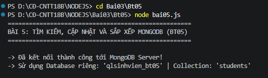
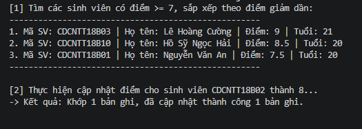
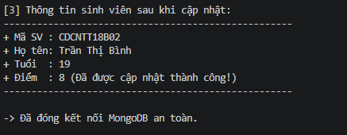
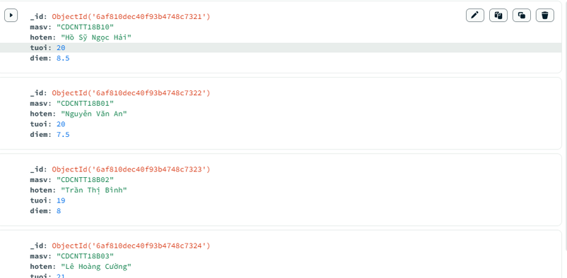

# BÀI TẬP 5: TÌM KIẾM, CẬP NHẬT VÀ SẮP XẾP MONGODB (BT05)

## 1. Thông Tin Sinh Viên
- **Họ và tên:** Hồ Sỹ Ngọc Hải
- **Mã sinh viên:** CDCNTT18B10
- **Lớp:** CĐ-CNTT18B
- **Môn học:** Lập trình Node.js (Bài 3 — Module, File System và cơ sở dữ liệu)

---

## 2. Mục Tiêu & Cơ Sở Dữ Liệu Độc Lập
Bài tập được thiết lập với **Database MongoDB độc lập (`qlsinhvien_bt05`)** và cơ chế tự nạp dữ liệu mẫu ban đầu, giúp bài tập có thể chạy, kiểm tra và nộp hoàn toàn độc lập mà không phụ thuộc vào Bài 4:
1. Kết nối cơ sở dữ liệu MongoDB đang chạy trên máy cục bộ (`mongodb://localhost:27017/`).
2. Sử dụng Database riêng biệt: **`qlsinhvien_bt05`**, Collection: **`students`**.
3. Tìm các sinh viên có điểm từ 7 trở lên (`diem >= 7`) bằng phương thức `find()` và toán tử so sánh `$gte`.
4. Sắp xếp kết quả theo điểm giảm dần bằng phương thức `sort({ diem: -1 })`.
5. Cập nhật điểm của một sinh viên theo mã sinh viên (`masv`) bằng phương thức `updateOne()` và toán tử `$set`.
6. Hiển thị lại thông tin của sinh viên sau khi cập nhật để đối chiếu và kiểm tra kết quả.
7. Đóng kết nối MongoDB sau khi hoàn thành.

---

## 3. Cấu Trúc Thư Mục
```text
Bt05/
├── bai05.js           # Tập tin mã nguồn tìm kiếm, cập nhật và sắp xếp MongoDB
├── package.json       # Cấu hình dự án và dependencies độc lập
├── package-lock.json  # Khóa phiên bản dependencies chính xác
├── anh1bt5.png        # Ảnh Terminal chạy lệnh và kết nối MongoDB thành công
├── anh2bt5.png    # Ảnh Terminal lọc điểm >= 7, sắp xếp và cập nhật điểm
├── anh3bt5.png    # Ảnh Terminal hiển thị thông tin sinh viên sau khi cập nhật
├── anh4bt5.png    # Ảnh MongoDB Compass xác nhận điểm sinh viên đã cập nhật
└── README.md      # Tài liệu mô tả các lệnh thực hiện và kết quả
```

---

## 4. Mô Tả Các Bước & Lệnh Thực Hiện

### Bước 1: Khởi động dịch vụ MongoDB
Đảm bảo MongoDB Server đang chạy trên máy tính.

### Bước 2: Mở Terminal trong Visual Studio Code
Mở thư mục dự án `D:\CĐ-CNTT18B\NODEJS` trong VS Code, mở Terminal tích hợp (`Ctrl + \``).

### Bước 3: Di chuyển vào thư mục bài tập Bt05
```powershell
cd Bai03\Bt05
```

### Bước 4: Thực thi chương trình
Chạy tập tin `bai05.js` bằng lệnh:
```powershell
node bai05.js
```

---

## 5. Ảnh Chạy Các Bước & Kết Quả Thực Tế

### Bước 1: Khởi động chương trình & Kết nối MongoDB thành công
Terminal hiển thị thông báo kết nối thành công và xác nhận sử dụng Database riêng `qlsinhvien_bt05`:



---

### Bước 2: Tìm kiếm sinh viên có điểm $\ge 7$, sắp xếp giảm dần & Cập nhật điểm
Terminal hiển thị danh sách sinh viên được lọc bằng `$gte`, sắp xếp bằng `sort({ diem: -1 })` và thực hiện lệnh `updateOne()`:



---

### Bước 3: Hiển thị thông tin sinh viên sau khi cập nhật & Đóng kết nối
Terminal xác nhận điểm sinh viên `CDCNTT18B02` (Trần Thị Bình) đã được cập nhật thành công lên 8 và đóng kết nối an toàn:



---

### Bước 4: Kiểm tra dữ liệu thực tế trên MongoDB Compass
Giao diện MongoDB Compass xác nhận điểm của sinh viên `CDCNTT18B02` (Trần Thị Bình) trong database `qlsinhvien_bt05` đã được cập nhật thành 8:



---

## 6. Kết Quả Hiển Thị Chi Tiết Trên Terminal
```text
PS D:\CĐ-CNTT18B\NODEJS> cd Bai03\Bt05
PS D:\CĐ-CNTT18B\NODEJS\Bai03\Bt05> node bai05.js
====================================================
BÀI 5: TÌM KIẾM, CẬP NHẬT VÀ SẮP XẾP MONGODB (BT05)
====================================================

-> Đã kết nối thành công tới MongoDB Server!
-> Sử dụng Database riêng: 'qlsinhvien_bt05' | Collection: 'students'

[1] Tìm các sinh viên có điểm >= 7, sắp xếp theo điểm giảm dần:
----------------------------------------------------
1. Mã SV: CDCNTT18B03 | Họ tên: Lê Hoàng Cường | Điểm: 9 | Tuổi: 21
2. Mã SV: CDCNTT18B10 | Họ tên: Hồ Sỹ Ngọc Hải | Điểm: 8.5 | Tuổi: 20
3. Mã SV: CDCNTT18B01 | Họ tên: Nguyễn Văn An | Điểm: 7.5 | Tuổi: 20
----------------------------------------------------

[2] Thực hiện cập nhật điểm cho sinh viên CDCNTT18B02 thành 8...
-> Kết quả: Khớp 1 bản ghi, đã cập nhật thành công 1 bản ghi.

[3] Thông tin sinh viên sau khi cập nhật:
----------------------------------------------------
+ Mã SV : CDCNTT18B02
+ Họ tên: Trần Thị Bình
+ Tuổi  : 19
+ Điểm  : 8 (Đã được cập nhật thành công!)
----------------------------------------------------

-> Đã đóng kết nối MongoDB an toàn.
```

---

## 7. Giải Thích Các Phương Thức & Tính Năng Tối Ưu
1. **Khả năng chạy độc lập:** `bai05.js` tự động chuẩn bị dữ liệu mẫu cho Database riêng `qlsinhvien_bt05`, cho phép mở riêng thư mục `Bt05` để chạy và chấm bài mà không cần phải chạy Bài 4 trước.
2. **Database riêng biệt (`qlsinhvien_bt05`):** Không gây xung đột hay biến đổi dữ liệu của `qlsinhvien` trong Bài 4.
3. **Toán tử so sánh `$gte` (Greater Than or Equal):** Lọc chính xác các bản ghi có `diem >= 7`.
4. **Phương thức `sort({ diem: -1 })`:** Sắp xếp danh sách trả về theo thứ tự điểm giảm dần (từ 9 xuống 8.5, 7.5).
5. **Cập nhật bằng `updateOne()` & `$set`:** Sửa đổi chính xác trường `diem` của sinh viên `CDCNTT18B02` thành 8 mà không làm thay đổi các trường dữ liệu khác.
6. **Kiểm tra với `findOne()`:** Truy vấn ngay lại sinh viên vừa cập nhật để in ra màn hình chứng minh kết quả thực thi.
