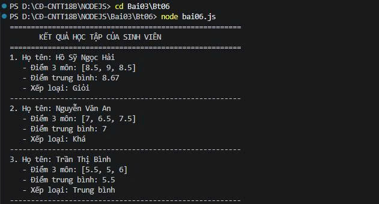

# BÀI TẬP 6: XÂY DỰNG MODULE TÍNH KẾT QUẢ HỌC TẬP

## 1. Thông Tin Sinh Viên
- **Họ và tên:** Hồ Sỹ Ngọc Hải
- **Mã sinh viên:** CDCNTT18B10
- **Lớp:** CĐ-CNTT18B
- **Môn học:** Lập trình Node.js (Bài thực hành số 03)

---

## 2. Mục Tiêu & Yêu Cầu Bài Thực Hành
Xây dựng module và chương trình tính điểm trung bình, xếp loại học tập cho sinh viên bằng Node.js:
1. **Module `xulyDiem.js`:**
   - Xây dựng hàm `tinhDiemTrungBinh(m1, m2, m3)` tính điểm trung bình của 3 môn học.
   - Xây dựng hàm `xepLoai(dtb)` xếp loại học tập theo tiêu chí:
     - **Giỏi:** Điểm trung bình từ 8.0 trở lên (`dtb >= 8.0`).
     - **Khá:** Điểm trung bình từ 6.5 đến dưới 8.0 (`6.5 <= dtb < 8.0`).
     - **Trung bình:** Điểm trung bình từ 5.0 đến dưới 6.5 (`5.0 <= dtb < 6.5`).
     - **Yếu:** Điểm trung bình dưới 5.0 (`dtb < 5.0`).
   - Xuất các hàm ra ngoài bằng `module.exports`.
2. **Chương trình chính `bai06.js`:**
   - Sử dụng `require('./xulyDiem')` để import các hàm từ module.
   - Khởi tạo danh sách 3 sinh viên, trong đó có sinh viên **Hồ Sỹ Ngọc Hải (CDCNTT18B10)**.
   - Gọi hàm tính toán và hiển thị thông tin gồm: Họ tên, Điểm từng môn, Điểm trung bình và Xếp loại lên Terminal.

---

## 3. Cấu Trúc Thư Mục
```text
Bt06/
├── image/
│   └── anh.jpg        # Ảnh chụp màn hình kết quả chạy chương trình trên Terminal
├── xulyDiem.js        # Module chứa các hàm tính điểm trung bình và xếp loại
├── bai06.js           # Tập tin chính khởi tạo dữ liệu và hiển thị kết quả ra Terminal
└── README.md          # Tài liệu hướng dẫn chi tiết và kết quả thực hiện
```

---

## 4. Hướng Dẫn Thực Hiện

### Bước 1: Mở Terminal và di chuyển vào thư mục bài tập
```powershell
cd D:\CĐ-CNTT18B\NODEJS\Bai03\Bt06
```

### Bước 2: Thực thi chương trình
```powershell
node bai06.js
```

---

## 5. Hình Ảnh Minh Họa Kết Quả

Hình ảnh chụp màn hình kết quả chạy tập tin `bai06.js` trên Terminal:



---

## 6. Bảng Tổng Hợp Kết Quả Học Tập

| STT | Họ và Tên Sinh Viên | Mã Sinh Viên | Điểm Môn 1 | Điểm Môn 2 | Điểm Môn 3 | Điểm Trung Bình | Xếp Loại Học Tập |
| :-: | :--- | :-: | :-: | :-: | :-: | :-: | :-: |
| **1** | **Hồ Sỹ Ngọc Hải** | **CDCNTT18B10** | **8.5** | **9.0** | **8.5** | **8.67** | **Giỏi** |
| **2** | Nguyễn Văn An | CDCNTT18B01 | 7.0 | 6.5 | 7.5 | **7.00** | **Khá** |
| **3** | Trần Thị Bình | CDCNTT18B15 | 5.5 | 5.0 | 6.0 | **5.50** | **Trung bình** |

---

## 7. Kết Quả Hiển Thị Chi Tiết Trên Terminal

```text
PS D:\CĐ-CNTT18B\NODEJS> cd Bai03\Bt06
PS D:\CĐ-CNTT18B\NODEJS\Bai03\Bt06> node bai06.js
=======================================================
       KẾT QUẢ HỌC TẬP CỦA SINH VIÊN
=======================================================
1. Họ tên: Hồ Sỹ Ngọc Hải
   - Điểm 3 môn: [8.5, 9, 8.5]
   - Điểm trung bình: 8.67
   - Xếp loại: Giỏi
-------------------------------------------------------
2. Họ tên: Nguyễn Văn An
   - Điểm 3 môn: [7, 6.5, 7.5]
   - Điểm trung bình: 7
   - Xếp loại: Khá
-------------------------------------------------------
3. Họ tên: Trần Thị Bình
   - Điểm 3 môn: [5.5, 5, 6]
   - Điểm trung bình: 5.5
   - Xếp loại: Trung bình
-------------------------------------------------------
```

> [!NOTE]
> Module `xulyDiem.js` được thiết kế độc lập, tái sử dụng cao, tuân thủ chuẩn CommonJS (`module.exports` và `require`).
