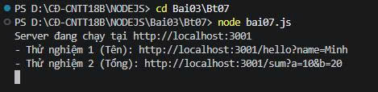
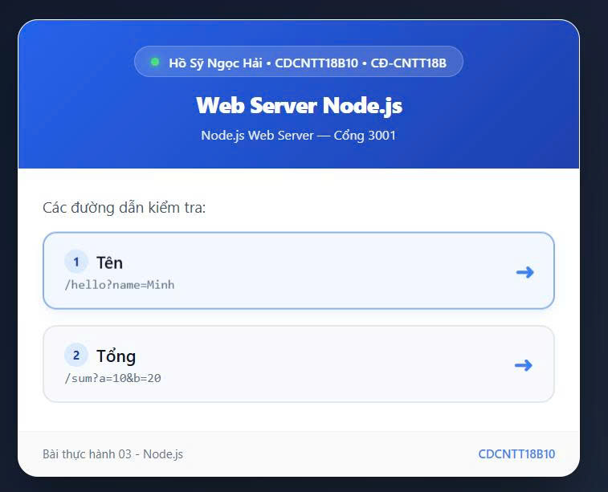
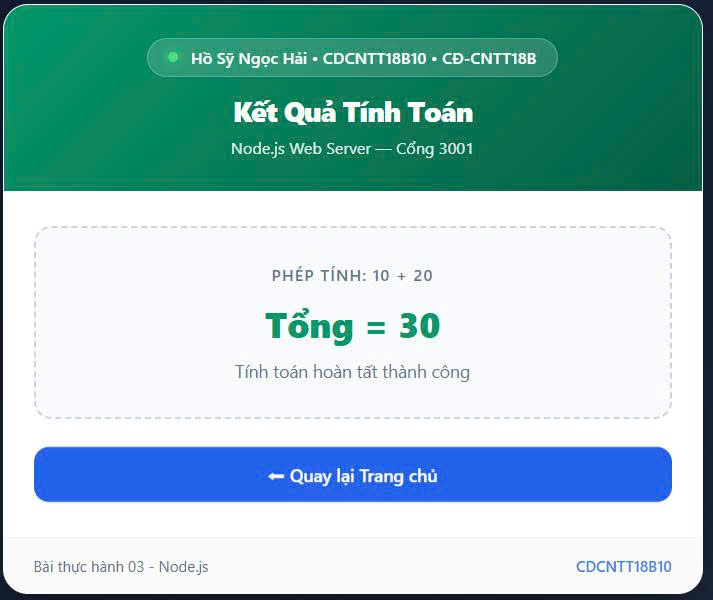
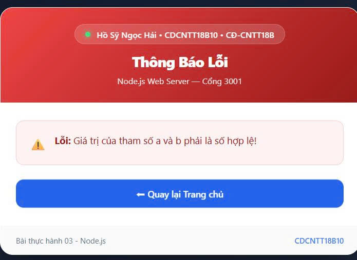
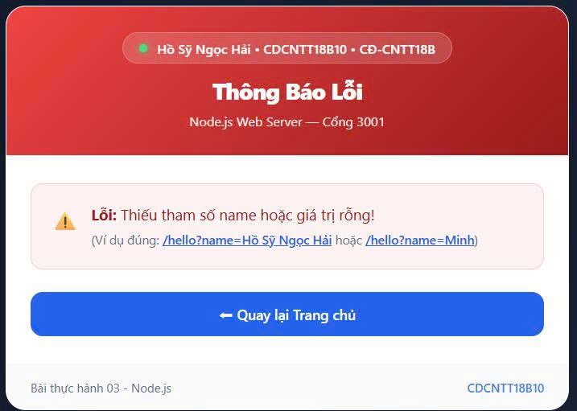

# BÀI TẬP 7: XỬ LÝ THAM SỐ URL TRÊN WEB SERVER

## 1. Thông Tin Sinh Viên
- **Họ và tên:** Hồ Sỹ Ngọc Hải
- **Mã sinh viên:** CDCNTT18B10
- **Lớp:** CĐ-CNTT18B
- **Môn học:** Lập trình Node.js (Bài thực hành số 03)

---

## 2. Mục Tiêu & Yêu Cầu Bài Thực Hành
Tạo Web Server bằng module `http` và xử lý tham số truy vấn bằng đối tượng `URL`:
- Khởi tạo Web Server lắng nghe tại cổng `3001`.
- Giao diện HTML5 & CSS hiện đại, cá nhân hóa thông tin sinh viên (**Hồ Sỹ Ngọc Hải - CDCNTT18B10 - CĐ-CNTT18B**).
- Tại trang chủ (`/`), hiển thị danh sách các thẻ liên kết chuyển tiếp trực quan theo đúng đề bài:
  - **1. Tên:** Chuyển tiếp tới `/hello?name=Minh` và hiển thị `Xin chào Minh`.
  - **2. Tổng:** Chuyển tiếp tới `/sum?a=10&b=20` và hiển thị `Tổng = 30`.
- Tại các trang con có nút bấm **⬅ Quay lại Trang chủ** để thuận tiện kiểm tra.
- Hỗ trợ phục vụ hình ảnh tĩnh trực tiếp từ thư mục `image/` (`/image/:filename`).
- Bắt lỗi và hiển thị thông báo lỗi rõ ràng nếu:
  - Thiếu tham số bắt buộc (ví dụ không truyền `name` hoặc thiếu một trong hai tham số `a`, `b`).
  - Giá trị tham số không hợp lệ (ví dụ `a` hoặc `b` không phải là số hợp lệ).
- Lệnh chạy: `node bai07.js`.

---

## 3. Cấu Trúc Thư Mục
```text
Bt07/
├── image/
│   ├── anh1.jpg       # Ảnh chụp màn hình khởi động Web Server trên Terminal
│   ├── anh2.jpg       # Ảnh chụp màn hình Trang chủ Web Server (http://localhost:3001)
│   ├── anh3.jpg       # Ảnh chụp màn hình kết quả chức năng Tên (/hello?name=Minh)
│   ├── anh4.jpg       # Ảnh chụp màn hình kết quả chức năng Tổng (/sum?a=10&b=20)
│   ├── anh5.jpg       # Ảnh chụp màn hình thông báo lỗi khi tham số không hợp lệ (/sum?a=10&b=abc)
│   └── anh6.jpg       # Ảnh chụp màn hình thông báo lỗi khi thiếu tham số name (/hello)
├── bai07.js           # Tập tin mã nguồn Web Server, giao diện CSS và xử lý URL
└── README.md          # Tài liệu hướng dẫn chi tiết và kết quả thực hiện
```

---

## 4. Hướng Dẫn Thực Hiện

### Bước 1: Mở Terminal và di chuyển vào thư mục bài tập Bt07
```powershell
cd D:\CĐ-CNTT18B\NODEJS\Bai03\Bt07
```

### Bước 2: Khởi động Web Server
```powershell
node bai07.js
```

---

## 5. Mô Tả Chi Tiết Các Bước & Hình Ảnh Minh Họa

### Bước 1: Khởi động Web Server trên Terminal
Khi chạy lệnh `node bai07.js`, server khởi tạo thành công tại cổng `3001` và in ra banner thông tin sinh viên cùng các đường dẫn thử nghiệm:



---

### Bước 2: Truy cập Trang chủ Web Server (`http://localhost:3001`)
Mở trình duyệt truy cập `http://localhost:3001`. Giao diện hiển thị thanh định danh cá nhân tác giả **Hồ Sỹ Ngọc Hải • CDCNTT18B10 • CĐ-CNTT18B** cùng 2 thẻ liên kết chuyển tiếp trực quan:



---

### Bước 3: Kiểm tra chức năng Tên (`/hello?name=Minh`)
Khi click vào thẻ **1. Tên** (hoặc truy cập trực tiếp `http://localhost:3001/hello?name=Minh`), Web Server lấy giá trị của tham số `name` và hiển thị lời chào `Xin chào Minh`:


---

### Bước 4: Kiểm tra chức năng Tổng (`/sum?a=10&b=20`)
Khi click vào thẻ **2. Tổng** (hoặc truy cập trực tiếp `http://localhost:3001/sum?a=10&b=20`), Web Server lấy 2 tham số `a` và `b`, kiểm tra tính hợp lệ của số và tính tổng hiển thị `Tổng = 30`:



---

### Bước 5: Kiểm tra cơ chế xử lý lỗi khi tham số không hợp lệ
Khi người dùng nhập tham số không phải là số hợp lệ (ví dụ: `http://localhost:3001/sum?a=10&b=abc`), hệ thống tự động phát hiện, trả về HTTP status code `400` kèm giao diện thông báo lỗi trực quan:



---

### Bước 6: Kiểm tra cơ chế xử lý lỗi khi thiếu tham số name
Khi người dùng truy cập vào đường dẫn `/hello` nhưng không truyền hoặc truyền rỗng tham số `name` (ví dụ: `http://localhost:3001/hello`), Web Server trả về mã lỗi HTTP `400` và hiển thị hộp thoại cảnh báo:



---

## 6. Bảng Tổng Hợp Các Tuyến Đường (Endpoints)

| STT | Tên Chức Năng | Phương Thức | Tuyến Đường (Route) | Tham Số Yêu Cầu | Kết Quả Trả Về |
| :-: | :--- | :-: | :--- | :--- | :--- |
| **1** | **Trang chủ** | `GET` | `/` | Không có | Giao diện điều hướng có liên kết **Tên** và **Tổng** |
| **2** | **Lời chào** | `GET` | `/hello?name=Minh` | `name` (chuỗi ký tự) | `Xin chào Minh` |
| **3** | **Tính tổng** | `GET` | `/sum?a=10&b=20` | `a`, `b` (số hợp lệ) | `Tổng = 30` (phép tính `10 + 20`) |
| **4** | **Báo lỗi giá trị số** | `GET` | `/sum?a=10&b=abc` | Sai kiểu dữ liệu | `Lỗi: Giá trị của tham số a và b phải là số hợp lệ!` |
| **5** | **Báo lỗi thiếu name** | `GET` | `/hello` | Thiếu tham số | `Lỗi: Thiếu tham số name hoặc giá trị rỗng!` |
| **6** | **Tập tin ảnh tĩnh** | `GET` | `/image/:filename` | Tên tập tin ảnh | Trả về dữ liệu ảnh trực tiếp từ thư mục `image/` |

---

## 7. Xử Lý Các Trường Hợp Lỗi (Validation)

Chương trình bắt lỗi chặt chẽ và hiển thị cảnh báo đỏ trực quan khi người dùng nhập sai tham số:

1. **Thiếu tham số `name`:**
   - URL: `http://localhost:3001/hello`
   - Thông báo lỗi: `Lỗi: Thiếu tham số name hoặc giá trị rỗng! (Ví dụ đúng: /hello?name=Hồ Sỹ Ngọc Hải hoặc /hello?name=Minh)` *(Xem minh họa tại Bước 6 - ảnh `image/anh6.jpg`)*
2. **Thiếu một trong hai tham số `a` hoặc `b`:**
   - URL: `http://localhost:3001/sum?a=15`
   - Thông báo lỗi: `Lỗi: Thiếu tham số! Vui lòng truyền đủ cả hai tham số a và b. (Ví dụ đúng: /sum?a=10&b=20)`
3. **Giá trị tham số không phải là số hợp lệ:**
   - URL: `http://localhost:3001/sum?a=10&b=abc`
   - Thông báo lỗi: `Lỗi: Giá trị của tham số a và b phải là số hợp lệ!` *(Xem minh họa tại Bước 5 - ảnh `image/anh5.jpg`)*
4. **Đường dẫn không tồn tại (Lỗi 404):**
   - URL: `http://localhost:3001/duong-dan-la`
   - Thông báo lỗi: `Lỗi 404: Đường dẫn bạn yêu cầu không tồn tại trên hệ thống!`
