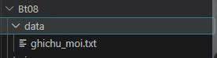
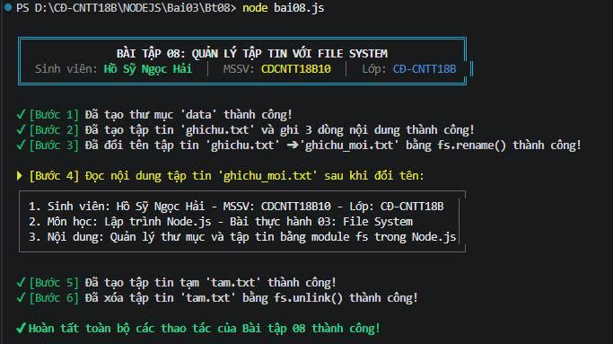

# BÀI TẬP 8: QUẢN LÝ TẬP TIN VỚI FILE SYSTEM (FS MODULE)

## 1. Thông Tin Sinh Viên
- **Họ và tên:** Hồ Sỹ Ngọc Hải
- **Mã sinh viên:** CDCNTT18B10
- **Lớp:** CĐ-CNTT18B
- **Môn học:** Lập trình Node.js (Bài 3 — Module, File System và cơ sở dữ liệu)

---

## 2. Mục Tiêu & Yêu Cầu Bài Thực Hành
Tạo tập tin `bai08.js` sử dụng module `fs` để thực hiện quản lý thư mục và tập tin:
1. Tạo thư mục `data` và tập tin `ghichu.txt` bên trong thư mục `data`.
2. Ghi vào tập tin ít nhất 3 dòng nội dung (chứa thông tin cá nhân và nội dung ghi chú).
3. Đổi tên tập tin `ghichu.txt` thành `ghichu_moi.txt` bằng phương thức `fs.rename()`.
4. Đọc và hiển thị nội dung của tập tin sau khi đổi tên lên Terminal bằng `fs.readFile()`.
5. Tạo tập tin `tam.txt`, sau đó xóa bỏ tập tin này bằng phương thức `fs.unlink()`.
6. Hiển thị thông báo rõ ràng cho từng thao tác trên Terminal.
7. Lệnh chạy: `node bai08.js`.

---

## 3. Cấu Trúc Thư Mục
```text
Bt08/
├── data/
│   └── ghichu_moi.txt # Tập tin sau khi được đổi tên và lưu trữ nội dung ghi chú
├── image/
│   ├── anh1.jpg       # Ảnh cấu trúc thư mục data và tập tin ghichu_moi.txt trên VS Code
│   └── anh2.jpg       # Ảnh Terminal thực thi toàn bộ 6 bước quản lý File System
├── bai08.js           # Mã nguồn thực thi các thao tác File System
└── README.md          # Tài liệu hướng dẫn chi tiết và kết quả thực hiện
```

---

## 4. Hướng Dẫn Thực Hiện

### Bước 1: Mở Terminal trong Visual Studio Code
Mở thư mục dự án `D:\CĐ-CNTT18B\NODEJS` trong Visual Studio Code và mở Terminal (`Ctrl + \``).

### Bước 2: Di chuyển vào thư mục bài tập Bt08
```powershell
cd Bai03\Bt08
```

### Bước 3: Thực thi chương trình
```powershell
node bai08.js
```

---

## 5. Hình Ảnh Minh Họa Kết Quả Thực Tế

### Ảnh 1: Cấu trúc thư mục `data` và tập tin `ghichu_moi.txt`
Hình ảnh trong thanh Explorer của Visual Studio Code xác nhận thư mục `data` đã được khởi tạo và tập tin được đổi tên thành công sang `ghichu_moi.txt`:



---

### Ảnh 2: Toàn bộ quá trình thực thi trên Terminal
Terminal hiển thị đầy đủ Banner thông tin sinh viên **Hồ Sỹ Ngọc Hải (CDCNTT18B10)** cùng kết quả từng bước: tạo thư mục, tạo tập tin, ghi 3 dòng, đổi tên tập tin, đọc nội dung và xóa file tạm:



---

## 6. Kết Quả Hiển Thị Chi Tiết Trên Terminal

```text
PS D:\CĐ-CNTT18B\NODEJS\Bai03\Bt08> node bai08.js

╔══════════════════════════════════════════════════════════════════════╗
║               BÀI TẬP 08: QUẢN LÝ TẬP TIN VỚI FILE SYSTEM            ║
║  Sinh viên: Hồ Sỹ Ngọc Hải  │  MSSV: CDCNTT18B10  │  Lớp: CĐ-CNTT18B  ║
╚══════════════════════════════════════════════════════════════════════╝

✔ [Bước 1] Đã tạo thư mục 'data' thành công!
✔ [Bước 2] Đã tạo tập tin 'ghichu.txt' và ghi 3 dòng nội dung thành công!
✔ [Bước 3] Đã đổi tên tập tin 'ghichu.txt' ➔ 'ghichu_moi.txt' bằng fs.rename() thành công!

▶ [Bước 4] Đọc nội dung tập tin 'ghichu_moi.txt' sau khi đổi tên:
┌──────────────────────────────────────────────────────────────────────┐
│ 1. Sinh viên: Hồ Sỹ Ngọc Hải - MSSV: CDCNTT18B10 - Lớp: CĐ-CNTT18B  │
│ 2. Môn học: Lập trình Node.js - Bài thực hành 03: File System       │
│ 3. Nội dung: Quản lý thư mục và tập tin bằng module fs trong Node.js│
└──────────────────────────────────────────────────────────────────────┘

✔ [Bước 5] Đã tạo tập tin tạm 'tam.txt' thành công!
✔ [Bước 6] Đã xóa tập tin 'tam.txt' bằng fs.unlink() thành công!

✔ Hoàn tất toàn bộ các thao tác của Bài tập 08 thành công!
```

---

## 7. Giải Thích Các Phương Thức File System Đã Sử Dụng

| STT | Phương Thức | Mục Đích Sử Dụng Trong Bài |
| :-: | :--- | :--- |
| **1** | `fs.mkdir(path, { recursive: true }, callback)` | Tạo thư mục `data` an toàn (không báo lỗi nếu thư mục đã tồn tại trước đó). |
| **2** | `fs.writeFile(file, data, 'utf8', callback)` | Tạo mới và ghi 3 dòng nội dung vào `ghichu.txt`, cũng như tạo file tạm `tam.txt`. |
| **3** | `fs.rename(oldPath, newPath, callback)` | Đổi tên tập tin từ `ghichu.txt` thành `ghichu_moi.txt` một cách nhanh chóng. |
| **4** | `fs.readFile(file, 'utf8', callback)` | Đọc và in dữ liệu tập tin `ghichu_moi.txt` lên màn hình với định dạng chuỗi UTF-8. |
| **5** | `fs.unlink(path, callback)` | Xóa tập tin tạm thời `tam.txt` khỏi hệ thống tập tin sau khi hoàn tất kiểm tra. |
