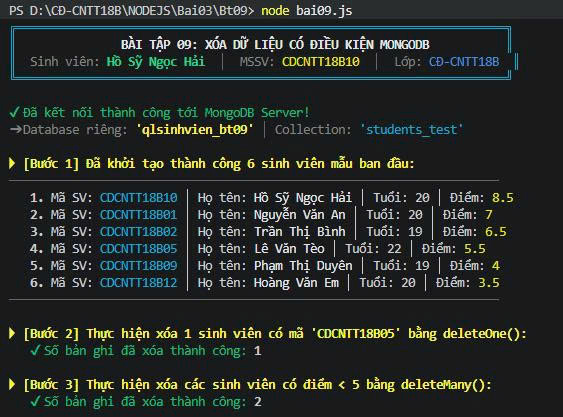
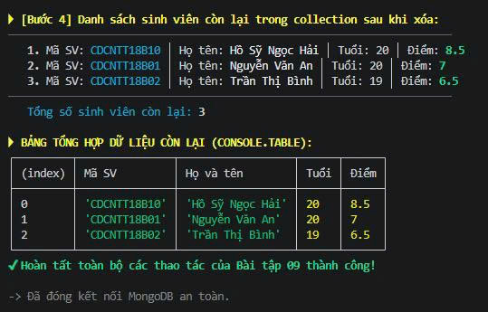
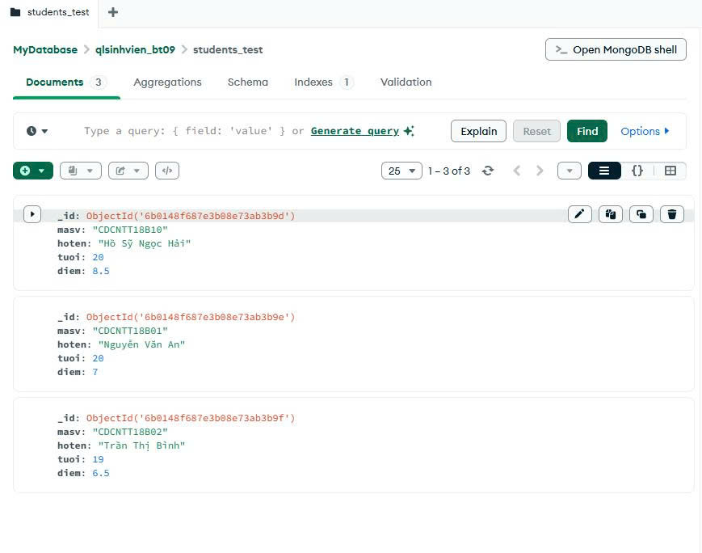

# BÀI TẬP 9: XÓA DỮ LIỆU CÓ ĐIỀU KIỆN TRONG MONGODB (BT09)

## 1. Thông Tin Sinh Viên
- **Họ và tên:** Hồ Sỹ Ngọc Hải
- **Mã sinh viên:** CDCNTT18B10
- **Lớp:** CĐ-CNTT18B
- **Môn học:** Lập trình Node.js (Bài 3 — Module, File System và cơ sở dữ liệu)

---

## 2. Mục Tiêu & Cơ Sở Dữ Liệu Độc Lập
Bài tập được thiết lập với **Database MongoDB riêng biệt (`qlsinhvien_bt09`)** và collection riêng (`students_test`) cùng thư viện `node_modules` cục bộ, giúp bài tập có thể chạy, kiểm tra và nộp hoàn toàn độc lập:
1. Kết nối cơ sở dữ liệu MongoDB local (`mongodb://localhost:27017/`).
2. Sử dụng Database riêng: **`qlsinhvien_bt09`**, Collection: **`students_test`**.
3. Thêm danh sách mẫu gồm 6 sinh viên (bao gồm sinh viên Hồ Sỹ Ngọc Hải CDCNTT18B10), mỗi sinh viên gồm các trường: `masv`, `hoten`, `tuoi`, `diem`.
4. Sử dụng phương thức `deleteOne()` để xóa một sinh viên theo mã sinh viên (`masv`).
5. Sử dụng phương thức `deleteMany()` để xóa toàn bộ các sinh viên có điểm dưới 5 (`diem < 5` sử dụng toán tử `$lt`).
6. Hiển thị số lượng bản ghi đã xóa ở từng thao tác và in danh sách các sinh viên còn lại trong collection bằng `find()`.
7. Đóng kết nối MongoDB sau khi hoàn thành công việc.
8. Lệnh chạy: `node bai09.js`.

---

## 3. Cấu Trúc Thư Mục
```text
Bt09/
├── image/
│   ├── anh1.jpg       # Ảnh Terminal: Khởi tạo 6 sinh viên và thực hiện xóa dữ liệu có điều kiện
│   ├── anh2.jpg       # Ảnh Terminal: Danh sách sinh viên còn lại và bảng tổng hợp console.table
│   └── anh3.jpg       # Ảnh MongoDB Compass: 3 bản ghi thực tế trong collection students_test
├── node_modules/      # Thư viện MongoDB driver độc lập cục bộ
├── bai09.js           # Mã nguồn xóa dữ liệu có điều kiện trong MongoDB
├── package.json       # Cấu hình dự án và dependencies độc lập
├── package-lock.json  # Khóa phiên bản thư viện chính xác
└── README.md          # Tài liệu hướng dẫn chi tiết và kết quả thực hiện
```

---

## 4. Hướng Dẫn Thực Hiện

### Bước 1: Khởi động dịch vụ MongoDB
Đảm bảo dịch vụ MongoDB Server đang hoạt động trên máy tính (hoặc mở ứng dụng MongoDB Compass).

### Bước 2: Mở Terminal trong Visual Studio Code
Mở thư mục dự án `D:\CĐ-CNTT18B\NODEJS` trong VS Code, mở Terminal tích hợp (`Ctrl + \``).

### Bước 3: Di chuyển vào thư mục bài tập Bt09
```powershell
cd Bai03\Bt09
```

### Bước 4: Thực thi chương trình
Chạy tập tin `bai09.js` bằng lệnh:
```powershell
node bai09.js
```

---

## 5. Hình Ảnh Minh Họa Kết Quả Thực Tế

### Ảnh 1: Terminal khởi tạo dữ liệu & Thực hiện các thao tác xóa
Terminal hiển thị Banner sinh viên **Hồ Sỹ Ngọc Hải (CDCNTT18B10)**, kết nối thành công tới Database riêng `qlsinhvien_bt09`, khởi tạo 6 sinh viên mẫu ban đầu, và thực hiện xóa với `deleteOne()` (1 bản ghi) cùng `deleteMany()` (2 bản ghi điểm < 5):



---

### Ảnh 2: Danh sách sinh viên còn lại & Bảng `console.table`
Terminal hiển thị danh sách 3 sinh viên đạt yêu cầu còn lại trong collection `students_test`, bảng kẻ ô tổng hợp dữ liệu chi tiết (`console.table`), và thông báo hoàn tất đóng kết nối:



---

### Ảnh 3: Kiểm tra dữ liệu trên MongoDB Compass
Giao diện MongoDB Compass kết nối database riêng **`qlsinhvien_bt09`** > collection **`students_test`**, xác nhận chính xác 3 tài liệu sinh viên còn lưu trữ trong cơ sở dữ liệu:



---

## 6. Bảng Tổng Hợp Dữ Liệu Sinh Viên Còn Lại

| STT | Mã Sinh Viên | Họ và Tên | Tuổi | Điểm | Trạng Thái Kiểm Tra |
| :-: | :--- | :--- | :-: | :-: | :--- |
| **1** | **CDCNTT18B10** | **Hồ Sỹ Ngọc Hải** | **20** | **8.5** | Giữ lại (Điểm >= 5.0) |
| **2** | CDCNTT18B01 | Nguyễn Văn An | 20 | 7.0 | Giữ lại (Điểm >= 5.0) |
| **3** | CDCNTT18B02 | Trần Thị Bình | 19 | 6.5 | Giữ lại (Điểm >= 5.0) |

> *Ghi chú:*
> - Sinh viên **CDCNTT18B05 (Lê Văn Tèo)** bị xóa bởi lệnh `deleteOne({ masv: 'CDCNTT18B05' })`.
> - Sinh viên **CDCNTT18B09 (Phạm Thị Duyên - Điểm: 4.0)** và **CDCNTT18B12 (Hoàng Văn Em - Điểm: 3.5)** bị xóa bởi lệnh `deleteMany({ diem: { $lt: 5 } })`.

---

## 7. Kết Quả Hiển Thị Chi Tiết Trên Terminal

```text
PS D:\CĐ-CNTT18B\NODEJS\Bai03\Bt09> node bai09.js

╔══════════════════════════════════════════════════════════════════════╗
║               BÀI TẬP 09: XÓA DỮ LIỆU CÓ ĐIỀU KIỆN MONGODB           ║
║  Sinh viên: Hồ Sỹ Ngọc Hải  │  MSSV: CDCNTT18B10  │  Lớp: CĐ-CNTT18B  ║
╚══════════════════════════════════════════════════════════════════════╝

✔ Đã kết nối thành công tới MongoDB Server!
➔ Database riêng: 'qlsinhvien_bt09' │ Collection: 'students_test'

▶ [Bước 1] Đã khởi tạo thành công 6 sinh viên mẫu ban đầu:
──────────────────────────────────────────────────────────────────────
   1. Mã SV: CDCNTT18B10 │ Họ tên: Hồ Sỹ Ngọc Hải │ Tuổi: 20 │ Điểm: 8.5
   2. Mã SV: CDCNTT18B01 │ Họ tên: Nguyễn Văn An │ Tuổi: 20 │ Điểm: 7
   3. Mã SV: CDCNTT18B02 │ Họ tên: Trần Thị Bình │ Tuổi: 19 │ Điểm: 6.5
   4. Mã SV: CDCNTT18B05 │ Họ tên: Lê Văn Tèo │ Tuổi: 22 │ Điểm: 5.5
   5. Mã SV: CDCNTT18B09 │ Họ tên: Phạm Thị Duyên │ Tuổi: 19 │ Điểm: 4
   6. Mã SV: CDCNTT18B12 │ Họ tên: Hoàng Văn Em │ Tuổi: 20 │ Điểm: 3.5
──────────────────────────────────────────────────────────────────────

▶ [Bước 2] Thực hiện xóa 1 sinh viên có mã 'CDCNTT18B05' bằng deleteOne():
   ✔ Số bản ghi đã xóa thành công: 1

▶ [Bước 3] Thực hiện xóa các sinh viên có điểm < 5 bằng deleteMany():
   ✔ Số bản ghi đã xóa thành công: 2

▶ [Bước 4] Danh sách sinh viên còn lại trong collection sau khi xóa:
──────────────────────────────────────────────────────────────────────
   1. Mã SV: CDCNTT18B10 │ Họ tên: Hồ Sỹ Ngọc Hải │ Tuổi: 20 │ Điểm: 8.5
   2. Mã SV: CDCNTT18B01 │ Họ tên: Nguyễn Văn An │ Tuổi: 20 │ Điểm: 7
   3. Mã SV: CDCNTT18B02 │ Họ tên: Trần Thị Bình │ Tuổi: 19 │ Điểm: 6.5
──────────────────────────────────────────────────────────────────────
   Tổng số sinh viên còn lại: 3

▶ BẢNG TỔNG HỢP DỮ LIỆU CÒN LẠI (CONSOLE.TABLE):
┌─────────┬───────────────┬──────────────────┬──────┬──────┐
│ (index) │ Mã SV         │ Họ và tên        │ Tuổi │ Điểm │
├─────────┼───────────────┼──────────────────┼──────┼──────┤
│ 0       │ 'CDCNTT18B10' │ 'Hồ Sỹ Ngọc Hải' │ 20   │ 8.5  │
│ 1       │ 'CDCNTT18B01' │ 'Nguyễn Văn An'  │ 20   │ 7    │
│ 2       │ 'CDCNTT18B02' │ 'Trần Thị Bình'  │ 19   │ 6.5  │
└─────────┴───────────────┴──────────────────┴──────┴──────┘
✔ Hoàn tất toàn bộ các thao tác của Bài tập 09 thành công!

-> Đã đóng kết nối MongoDB an toàn.
```

---

## 8. Giải Thích Mã Nguồn & Các Phương Thức MongoDB

| STT | Phương Thức / Toán Tử | Chức Năng Chi Tiết Trong Bài |
| :-: | :--- | :--- |
| **1** | `collection.deleteOne({ masv: 'CDCNTT18B05' })` | Xóa bản ghi đầu tiên thỏa mãn điều kiện `masv` bằng `'CDCNTT18B05'`. Trả về đối tượng có thuộc tính `deletedCount = 1`. |
| **2** | `collection.deleteMany({ diem: { $lt: 5 } })` | Xóa tất cả các bản ghi có trường `diem` nhỏ hơn 5 (`$lt` - Less Than). Trả về `deletedCount` là tổng số bản ghi bị xóa. |
| **3** | `collection.find({}).toArray()` | Truy vấn toàn bộ các bản ghi còn lại trong collection và chuyển thành mảng JavaScript để duyệt in ra màn hình. |
| **4** | `client.close()` | Đóng kết nối MongoDB giải phóng tài nguyên mạng và bộ nhớ. |
