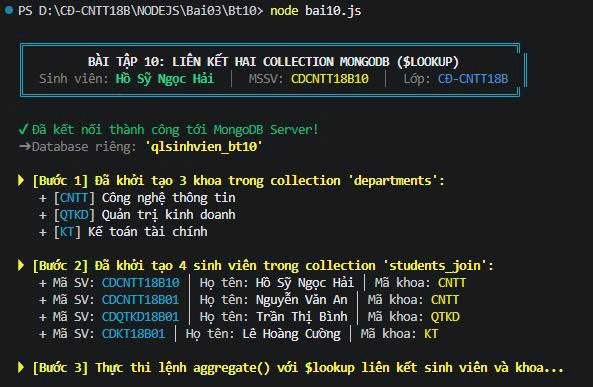
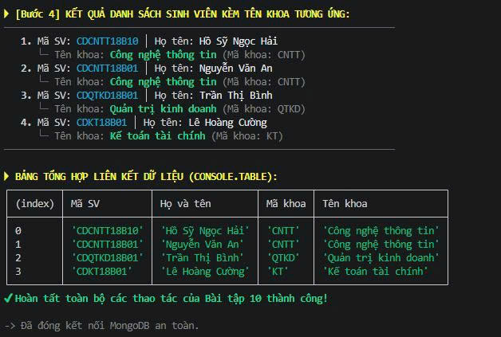
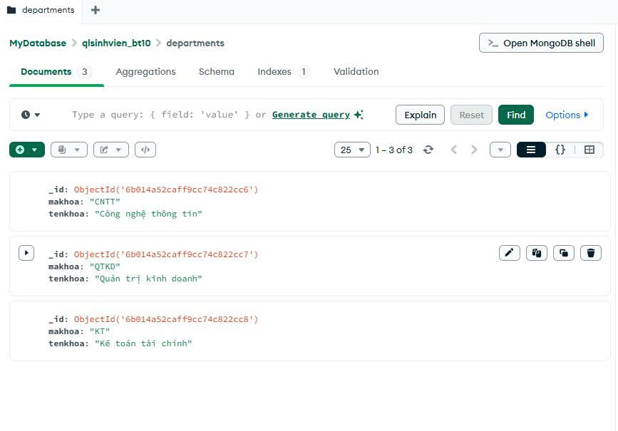
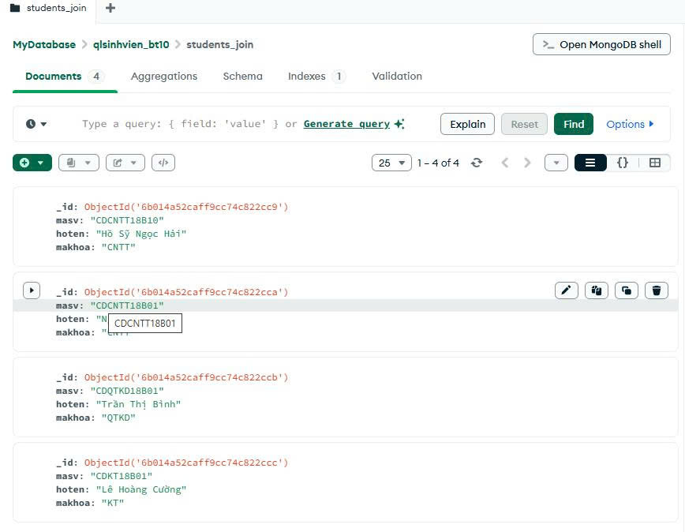

# BÀI TẬP 10: LIÊN KẾT HAI COLLECTION TRONG MONGODB ($LOOKUP)

## 1. Thông Tin Sinh Viên
- **Họ và tên:** Hồ Sỹ Ngọc Hải
- **Mã sinh viên:** CDCNTT18B10
- **Lớp:** CĐ-CNTT18B
- **Môn học:** Lập trình Node.js (Bài 3 — Module, File System và cơ sở dữ liệu)

---

## 2. Mục Tiêu & Cơ Sở Dữ Liệu Độc Lập
Bài tập được thiết lập với **Database MongoDB riêng biệt (`qlsinhvien_bt10`)** cùng thư viện `node_modules` cục bộ, giúp bài tập có thể chạy, kiểm tra và nộp hoàn toàn độc lập mà không ảnh hưởng tới các bài khác:
1. Kết nối cơ sở dữ liệu MongoDB local (`mongodb://localhost:27017/`), database riêng: **`qlsinhvien_bt10`**.
2. Tạo collection **`departments`** gồm 3 khoa, mỗi khoa có các trường `makhoa`, `tenkhoa`.
3. Tạo collection **`students_join`** gồm 4 sinh viên (bao gồm sinh viên Hồ Sỹ Ngọc Hải CDCNTT18B10), mỗi sinh viên có các trường `masv`, `hoten`, `makhoa`.
4. Sử dụng phương thức `aggregate()` kết hợp toán tử `$lookup` để liên kết thông tin sinh viên với khoa đào tạo thông qua trường khóa ngoại `makhoa`.
5. Đảm bảo kết quả truy vấn hiển thị đầy đủ cả mã khoa (`makhoa`) và tên khoa tương ứng (`tenkhoa`).
6. Đóng kết nối MongoDB an toàn sau khi hoàn thành.
7. Lệnh chạy: `node bai10.js`.

---

## 3. Cấu Trúc Thư Mục
```text
Bt10/
├── image/
│   ├── anh1.jpg       # Ảnh Terminal: Khởi tạo dữ liệu 3 khoa và 4 sinh viên
│   ├── anh2.jpg       # Ảnh Terminal: Kết quả liên kết $lookup và bảng console.table
│   ├── anh3.jpg       # Ảnh MongoDB Compass: Collection departments (3 khoa)
│   └── anh4.jpg       # Ảnh MongoDB Compass: Collection students_join (4 sinh viên)
├── node_modules/      # Thư viện MongoDB driver độc lập cục bộ
├── bai10.js           # Mã nguồn liên kết 2 collections bằng aggregate và $lookup
├── package.json       # Cấu hình dự án và dependencies độc lập
├── package-lock.json  # Khóa phiên bản thư viện chính xác
└── README.md          # Tài liệu hướng dẫn chi tiết và kết quả thực hiện
```

---

## 4. Hướng Dẫn Thực Hiện

### Bước 1: Khởi động dịch vụ MongoDB
Đảm bảo dịch vụ MongoDB Server đang hoạt động trên máy tính (hoặc mở ứng dụng MongoDB Compass).

### Bước 2: Mở Terminal trong Visual Studio Code
Mở thư mục dự án `D:\CĐ-CNTT18B\NODEJS` trong VS Code, mở Terminal tích hợp (`Ctrl + \``).

### Bước 3: Di chuyển vào thư mục bài tập Bt10
```powershell
cd Bai03\Bt10
```

### Bước 4: Thực thi chương trình
Chạy tập tin `bai10.js` bằng lệnh:
```powershell
node bai10.js
```

---

## 5. Hình Ảnh Minh Họa Kết Quả Thực Tế

### Ảnh 1: Khởi tạo collections `departments` và `students_join` trên Terminal
Terminal hiển thị Banner sinh viên **Hồ Sỹ Ngọc Hải (CDCNTT18B10)**, kết nối Database riêng `qlsinhvien_bt10`, khởi tạo 3 khoa trong `departments` và 4 sinh viên trong `students_join`:



---

### Ảnh 2: Kết quả liên kết `$lookup` & Bảng `console.table`
Terminal hiển thị danh sách sinh viên kèm theo tên khoa tương ứng sau khi `$lookup` và bảng kẻ lưới tổng hợp dữ liệu chi tiết (`console.table`):



---

### Ảnh 3: Dữ liệu collection `departments` trên MongoDB Compass
Giao diện MongoDB Compass trong Database `qlsinhvien_bt10` > collection `departments` chứa thông tin 3 khoa đào tạo:



---

### Ảnh 4: Dữ liệu collection `students_join` trên MongoDB Compass
Giao diện MongoDB Compass trong Database `qlsinhvien_bt10` > collection `students_join` chứa thông tin 4 sinh viên mẫu:



---

## 6. Bảng Tổng Hợp Kết Quả Liên Kết ($lookup)

| STT | Mã Sinh Viên | Họ và Tên | Mã Khoa | Tên Khoa Tương Ứng |
| :-: | :--- | :--- | :-: | :--- |
| **1** | **CDCNTT18B10** | **Hồ Sỹ Ngọc Hải** | **CNTT** | **Công nghệ thông tin** |
| **2** | CDCNTT18B01 | Nguyễn Văn An | CNTT | Công nghệ thông tin |
| **3** | CDQTKD18B01 | Trần Thị Bình | QTKD | Quản trị kinh doanh |
| **4** | CDKT18B01 | Lê Hoàng Cường | KT | Kế toán tài chính |

---

## 7. Kết Quả Hiển Thị Chi Tiết Trên Terminal

```text
PS D:\CĐ-CNTT18B\NODEJS> cd Bai03\Bt10
PS D:\CĐ-CNTT18B\NODEJS\Bai03\Bt10> node bai10.js

╔══════════════════════════════════════════════════════════════════════╗
║         BÀI TẬP 10: LIÊN KẾT HAI COLLECTION MONGODB ($LOOKUP)         ║
║  Sinh viên: Hồ Sỹ Ngọc Hải  │  MSSV: CDCNTT18B10  │  Lớp: CĐ-CNTT18B  ║
╚══════════════════════════════════════════════════════════════════════╝

✔ Đã kết nối thành công tới MongoDB Server!
➔ Database riêng: 'qlsinhvien_bt10'

▶ [Bước 1] Đã khởi tạo 3 khoa trong collection 'departments':
   + [CNTT] Công nghệ thông tin
   + [QTKD] Quản trị kinh doanh
   + [KT] Kế toán tài chính

▶ [Bước 2] Đã khởi tạo 4 sinh viên trong collection 'students_join':
   + Mã SV: CDCNTT18B10 │ Họ tên: Hồ Sỹ Ngọc Hải │ Mã khoa: CNTT
   + Mã SV: CDCNTT18B01 │ Họ tên: Nguyễn Văn An │ Mã khoa: CNTT
   + Mã SV: CDQTKD18B01 │ Họ tên: Trần Thị Bình │ Mã khoa: QTKD
   + Mã SV: CDKT18B01 │ Họ tên: Lê Hoàng Cường │ Mã khoa: KT

▶ [Bước 3] Thực thi lệnh aggregate() với $lookup liên kết sinh viên và khoa...

▶ [Bước 4] KẾT QUẢ DANH SÁCH SINH VIÊN KÈM TÊN KHOA TƯƠNG ỨNG:
──────────────────────────────────────────────────────────────────────
   1. Mã SV: CDCNTT18B10 │ Họ tên: Hồ Sỹ Ngọc Hải
      └─ Tên khoa: Công nghệ thông tin (Mã khoa: CNTT)
   2. Mã SV: CDCNTT18B01 │ Họ tên: Nguyễn Văn An
      └─ Tên khoa: Công nghệ thông tin (Mã khoa: CNTT)
   3. Mã SV: CDQTKD18B01 │ Họ tên: Trần Thị Bình
      └─ Tên khoa: Quản trị kinh doanh (Mã khoa: QTKD)
   4. Mã SV: CDKT18B01 │ Họ tên: Lê Hoàng Cường
      └─ Tên khoa: Kế toán tài chính (Mã khoa: KT)
──────────────────────────────────────────────────────────────────────

▶ BẢNG TỔNG HỢP LIÊN KẾT DỮ LIỆU (CONSOLE.TABLE):
┌─────────┬───────────────┬──────────────────┬─────────┬───────────────────────┐
│ (index) │ Mã SV         │ Họ và tên        │ Mã khoa │ Tên khoa              │
├─────────┼───────────────┼──────────────────┼─────────┼───────────────────────┤
│ 0       │ 'CDCNTT18B10' │ 'Hồ Sỹ Ngọc Hải' │ 'CNTT'  │ 'Công nghệ thông tin' │
│ 1       │ 'CDCNTT18B01' │ 'Nguyễn Văn An'  │ 'CNTT'  │ 'Công nghệ thông tin' │
│ 2       │ 'CDQTKD18B01' │ 'Trần Thị Bình'  │ 'QTKD'  │ 'Quản trị kinh doanh' │
│ 3       │ 'CDKT18B01'   │ 'Lê Hoàng Cường' │ 'KT'    │ 'Kế toán tài chính'   │
└─────────┴───────────────┴──────────────────┴─────────┴───────────────────────┘
✔ Hoàn tất toàn bộ các thao tác của Bài tập 10 thành công!

-> Đã đóng kết nối MongoDB an toàn.
```

---

## 8. Giải Thích Pipeline $lookup Trong MongoDB

Pipeline tổng hợp dữ liệu sử dụng các giai đoạn (`stages`):

```javascript
const pipeline = [
    {
        // 1. Liên kết collection students_join với departments
        $lookup: {
            from: departmentsCol,         // Collection đích cần liên kết
            localField: 'makhoa',         // Trường khóa trong students_join
            foreignField: 'makhoa',       // Trường khóa trong departments
            as: 'thongTinKhoa'            // Tên mảng kết quả trả về
        }
    },
    {
        // 2. Làm phẳng mảng đối tượng liên kết
        $unwind: {
            path: '$thongTinKhoa',
            preserveNullAndEmptyArrays: true
        }
    },
    {
        // 3. Định hình đầu ra hiển thị mã khoa và tên khoa
        $project: {
            _id: 0,
            masv: 1,
            hoten: 1,
            makhoa: 1,
            tenkhoa: { $ifNull: ['$thongTinKhoa.tenkhoa', 'Chưa xác định'] }
        }
    }
];
```

| Toán Tử Pipeline | Ý Nghĩa Kỹ Thuật |
| :--- | :--- |
| **`$lookup`** | Tương đương phép `LEFT OUTER JOIN` trong SQL, tìm các bản ghi bên `departments` khớp `makhoa` với bản ghi hiện tại. |
| **`$unwind`** | Tách mảng `thongTinKhoa` thành một đối tượng duy nhất để truy xuất trường `tenkhoa` trực tiếp. |
| **`$project`** | Chọn lọc chính xác các trường cần hiển thị lên giao diện (`masv`, `hoten`, `makhoa`, `tenkhoa`), ẩn trường `_id`. |
