# BÀI 4: XÂY DỰNG WEB VỚI NỀN TẢNG EXPRESS & MÔ HÌNH MVC (BÀI TẬP VÍ DỤ)

## 1. Thông Tin Sinh Viên
- **Họ và tên:** Hồ Sỹ Ngọc Hải
- **Mã sinh viên:** CDCNTT18B10
- **Lớp:** CĐ-CNTT18B
- **Môn học:** Lập trình Node.js
- **Bài học:** Bài 4 — Xây dựng web với nền tảng Express (Express Framework)
- **Tài liệu tham khảo:** [hoctructuyencntt.github.io/NodeJS/Bai04.html](https://hoctructuyencntt.github.io/NodeJS/Bai04.html)

---

## 2. Mục Tiêu & Kiến Thức Cốt Lõi
Bài thực hành bao gồm việc đọc hiểu và hiện thực hóa đầy đủ toàn bộ các ví dụ mẫu từ giáo trình Bài 4:
1. **Khởi tạo ứng dụng Express đầu tiên:** Sử dụng `express()`, định nghĩa route gốc `/`, lắng nghe cổng `3000` và hiển thị đường link truy cập ngay trên Terminal.
2. **Quản lý Định tuyến (Routing):** Xử lý các đường dẫn URL (`/`, `/about`), tham số truy vấn (`req.query`), và trang 404 (Not Found).
3. **Phần mềm trung gian (Middleware):** Xây dựng middleware ghi log request URL trước khi chuyển tiếp bằng `next()`.
4. **Bộ máy mẫu (Template Engines):**
   - **Pug:** Cấu hình `view engine pug`, render dữ liệu động với cú pháp thụt dòng `#{name}`.
   - **Handlebars:** Tích hợp `express-handlebars`, cấu hình template không dùng layouts mặc định.
5. **Xử lý lỗi (Error Handling):** Sử dụng `body-parser` nhận dữ liệu form POST, kiểm tra điều kiện lỗi chia cho 0 hoặc dữ liệu không hợp lệ (`status 400`).
6. **Dự án thực tế với mô hình MVC (`my-express-app`):**
   - **Model (`calculatorModel.js`):** Đóng gói nghiệp vụ tính toán (+, -, *, /).
   - **Controller (`calculatorController.js`):** Nhận request, gọi model, điều khiển template view.
   - **View (`calculator.pug`):** Giao diện tương tác người dùng nhập số và chọn phép tính.
   - **Public (`styles.css`):** Phục vụ tệp tĩnh bằng middleware `express.static`.

---

## 3. Cấu Trúc Thư Mục
```text
Bai04/
└── Baitapvidu/
    ├── anh1.png                  # Ảnh Trình duyệt: Hello, Express! (Ví dụ 1)
    ├── anh2.png                  # Ảnh Terminal: Khởi chạy node app.js (Ví dụ 1)
    ├── anh3.png                  # Ảnh Terminal: Khởi chạy node express_error.js (Ví dụ 5)
    ├── anh4.png                  # Ảnh Trình duyệt: Form nhập phép chia Dividend/Divisor (Ví dụ 5)
    ├── anh5.png                  # Ảnh Trình duyệt: Kết quả chia hợp lệ Result: 0.5 (Ví dụ 5)
    ├── anh6.png                  # Ảnh Trình duyệt: Xử lý lỗi chia cho 0 Invalid input (Ví dụ 5)
    ├── anh7.png                  # Ảnh Terminal: Khởi chạy node express_handlebars.js (Ví dụ 4b)
    ├── anh8.png                  # Ảnh Trình duyệt: Render template Handlebars (Ví dụ 4b)
    ├── anh9.png                  # Ảnh Terminal: Khởi chạy node express_pug.js (Ví dụ 4a)
    ├── anh10.png                 # Ảnh Trình duyệt: Render template Pug (Ví dụ 4a)
    ├── anh11.png                 # Ảnh Terminal: Khởi chạy node express_route.js (Ví dụ 2)
    ├── anh12.png                 # Ảnh Trình duyệt: Route gốc Trang chủ (Ví dụ 2)
    ├── anh13.png                 # Ảnh Trình duyệt: Route /about Trang giới thiệu (Ví dụ 2)
    ├── anh14.png                 # Ảnh Trình duyệt: Route /users?name=Minh (Ví dụ 2)
    ├── anh15.png                 # Ảnh Trình duyệt: Route mặc định 404 Không tìm thấy trang (Ví dụ 2)
    ├── an16.png                  # Ảnh Terminal: Khởi chạy node app.js trong my-express-app (Ví dụ 6)
    ├── anh17.png                 # Ảnh Trình duyệt: Giao diện Form máy tính Calculator MVC (Ví dụ 6)
    ├── node_modules/             # Các thư viện phụ thuộc (express, pug, express-handlebars, body-parser)
    ├── views/                    # Thư mục template cho các ví dụ cơ bản
    │   ├── index.pug             # Template Pug (Ví dụ 4a)
    │   └── index.handlebars      # Template Handlebars (Ví dụ 4b)
    ├── my-express-app/           # Dự án ứng dụng máy tính Calculator chuẩn mô hình MVC
    │   ├── controllers/
    │   │   └── calculatorController.js # Điều khiển routing và xử lý logic tính toán
    │   ├── models/
    │   │   └── calculatorModel.js      # Mô hình chứa logic thực hiện 4 phép tính
    │   ├── public/
    │   │   └── styles.css              # Định dạng CSS giao diện tĩnh cho máy tính
    │   ├── views/
    │   │   └── calculator.pug          # Giao diện Form máy tính bằng Pug
    │   ├── app.js                      # Điểm khởi chạy chính của dự án MVC
    │   └── package.json                # Cấu hình dự án MVC
    ├── app.js                    # [Ví dụ 1] Ứng dụng Express đầu tiên
    ├── express_route.js          # [Ví dụ 2] Định tuyến Route trong Express
    ├── express_middleware.js     # [Ví dụ 3] Xử lý Middleware ghi log
    ├── express_pug.js            # [Ví dụ 4a] Tích hợp Template Engine Pug
    ├── express_handlebars.js     # [Ví dụ 4b] Tích hợp Template Engine Handlebars
    ├── express_error.js          # [Ví dụ 5] Form chia số và xử lý lỗi Error Handling
    ├── package.json              # Quản lý dependencies dự án tổng thể
    ├── package-lock.json         # Khóa phiên bản thư viện chính xác
    └── README.md                 # Tài liệu hướng dẫn chi tiết và báo cáo thực hành
```

---

## 4. Hướng Dẫn Cài Đặt & Thực Thi

### Bước 1: Mở Terminal và di chuyển vào thư mục bài tập
```powershell
cd D:\CĐ-CNTT18B\NODEJS\Bai04\Baitapvidu
```

### Bước 2: Cài đặt các thư viện phụ thuộc (Dependencies)
```powershell
npm install
```
> *Các thư viện đã cài đặt:* `express`, `body-parser`, `pug`, `express-handlebars`.

---

### Bước 3: Hướng dẫn chạy từng ví dụ mẫu (Hiển thị đường link trực tiếp trên Terminal)

#### Ví dụ 1: Ứng dụng Express đầu tiên
```powershell
node app.js
```
Terminal hiển thị:
```text
Server đang chạy tại: http://localhost:3000
Truy cập đường link: http://localhost:3000
```

---

#### Ví dụ 2: Định tuyến Route
```powershell
node express_route.js
```
Terminal hiển thị:
```text
Server đang chạy tại: http://localhost:3000
Các đường link truy cập nhanh:
  - Trang chủ:        http://localhost:3000/
  - Trang giới thiệu: http://localhost:3000/about
  - Trang người dùng: http://localhost:3000/users?name=Minh
  - Trang test 404:   http://localhost:3000/khongtontai
```

---

#### Ví dụ 3: Phần mềm trung gian (Middleware)
```powershell
node express_middleware.js
```
Terminal hiển thị:
```text
Server đang chạy tại: http://localhost:3000
Truy cập đường link: http://localhost:3000
```
- Khi client truy cập, Terminal ghi nhận log: `[LOG] Yêu cầu đến địa chỉ: /`

---

#### Ví dụ 4a: Template Engine Pug
```powershell
node express_pug.js
```
Terminal hiển thị:
```text
Server đang chạy tại: http://localhost:3000
Truy cập giao diện Pug: http://localhost:3000
```

---

#### Ví dụ 4b: Template Engine Handlebars
```powershell
node express_handlebars.js
```
Terminal hiển thị:
```text
Server đang chạy tại: http://localhost:3000
Truy cập giao diện Handlebars: http://localhost:3000
```

---

#### Ví dụ 5: Xử lý lỗi (Error Handling)
```powershell
node express_error.js
```
Terminal hiển thị:
```text
Server đang chạy tại: http://localhost:3000
Truy cập Form chia số: http://localhost:3000
```

---

#### Ví dụ 6: Dự án ứng dụng máy tính Calculator theo mô hình MVC (`my-express-app`)
```powershell
cd my-express-app
node app.js
```
Terminal hiển thị:
```text
Server đang chạy tại: http://localhost:3000
Truy cập ứng dụng Calculator MVC tại: http://localhost:3000/calculator
```

---

## 5. Hình Ảnh Minh Họa Kết Quả Thực Tế Từng Ví Dụ

### 5.1. Ví Dụ 1: Ứng Dụng Express Cơ Bản Đầu Tiên (`app.js`)
*Khởi chạy máy chủ Express trên Terminal:*

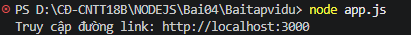

*Trình duyệt truy cập `http://localhost:3000/` nhận thông điệp phản hồi:*

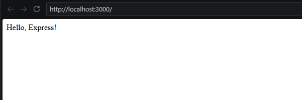

---

### 5.2. Ví Dụ 2: Định Tuyến Route Trong Express (`express_route.js`)
*Khởi chạy server và hiển thị các đường link nhanh trên Terminal:*

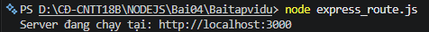

*1. Trang chủ (`/`):*

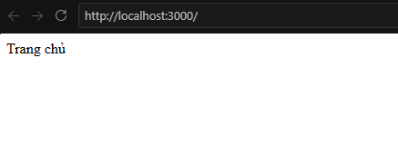

*2. Trang giới thiệu (`/about`):*

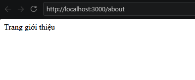

*3. Trang người dùng nhận tham số query (`/users?name=Minh`):*

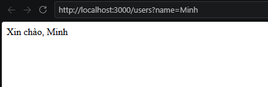

*4. Tuyến đường mặc định xử lý lỗi 404 (`/khongtontai`):*

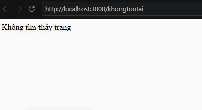

---

### 5.3. Ví Dụ 4a: Template Engine Pug (`express_pug.js`)
*Terminal thực thi chạy `node express_pug.js`:*

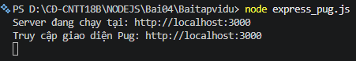

*Giao diện trình duyệt kết xuất từ template Pug (`views/index.pug`):*

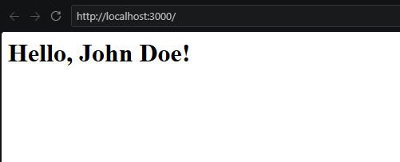

---

### 5.4. Ví Dụ 4b: Template Engine Handlebars (`express_handlebars.js`)
*Terminal thực thi chạy `node express_handlebars.js`:*

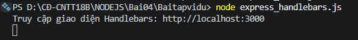

*Giao diện trình duyệt kết xuất từ template Handlebars (`views/index.handlebars`):*

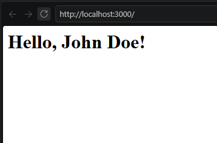

---

### 5.5. Ví Dụ 5: Xử Lý Lỗi - Error Handling (`express_error.js`)
*Terminal thực thi chạy máy chủ Form chia số:*

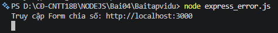

*Biểu mẫu nhập số bị chia (Dividend) và số chia (Divisor):*

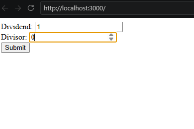

*Kết quả khi nhập dữ liệu hợp lệ (VD: 1 / 2):*

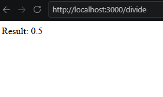

*Xử lý lỗi khi chia cho 0 hoặc dữ liệu không hợp lệ (Mã HTTP 400):*

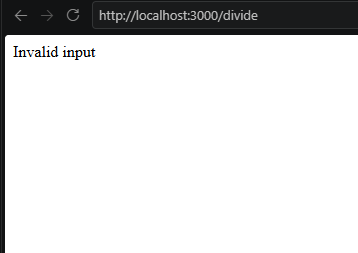

---

### 5.6. Ví Dụ 6: Dự Án Máy Tính MVC Calculator (`my-express-app`)
*Terminal di chuyển vào thư mục `my-express-app` và khởi chạy `node app.js`:*

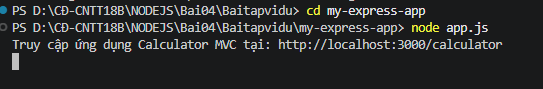

*Giao diện ứng dụng máy tính trực tuyến tại `http://localhost:3000/calculator`:*

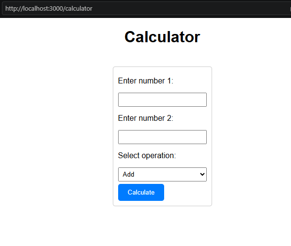

---

## 6. Phân Tích Kiến Trúc Mô Hình MVC Trong Dự Án Máy Tính

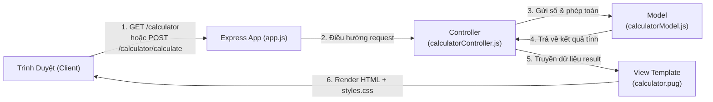

| Thành Phần | Tên Tập Tin | Vai Trò Chức Năng |
| :--- | :--- | :--- |
| **Model** | `models/calculatorModel.js` | Chứa logic tính toán thuần túy độc lập với giao diện (`add`, `subtract`, `multiply`, `divide`), xử lý kiểm tra chia cho 0 trả về `NaN`. |
| **View** | `views/calculator.pug`<br>`public/styles.css` | Định nghĩa cấu trúc trang nhập liệu và hiển thị kết quả bằng cú pháp Pug kết hợp định dạng CSS tĩnh. |
| **Controller** | `controllers/calculatorController.js` | Tiếp nhận yêu cầu HTTP từ client, trích xuất dữ liệu biểu mẫu `req.body`, gọi Model tính toán và chỉ định View tương ứng để render HTML. |
| **Application** | `app.js` | Khởi tạo server Express, nạp các middleware cốt lõi (`body-parser`, `express.static`), cấu hình view engine và xử lý lỗi tập trung. |
