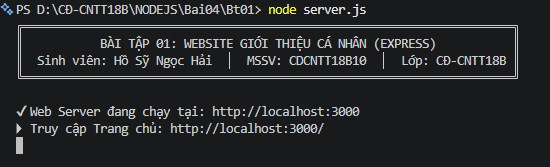
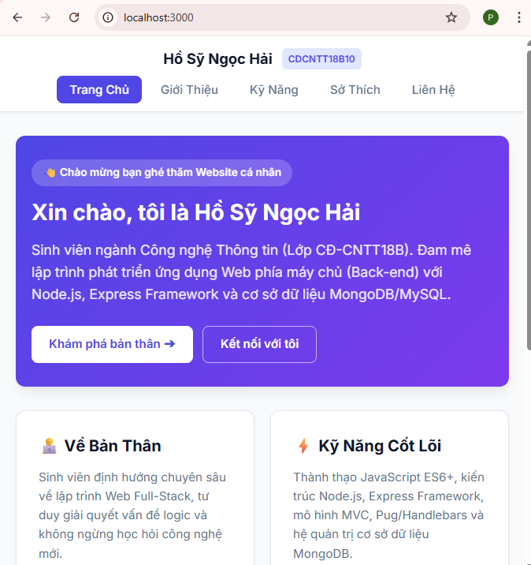
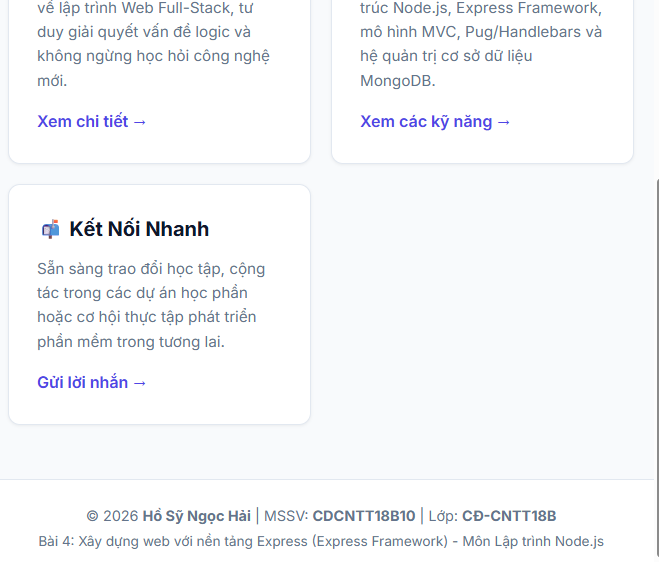
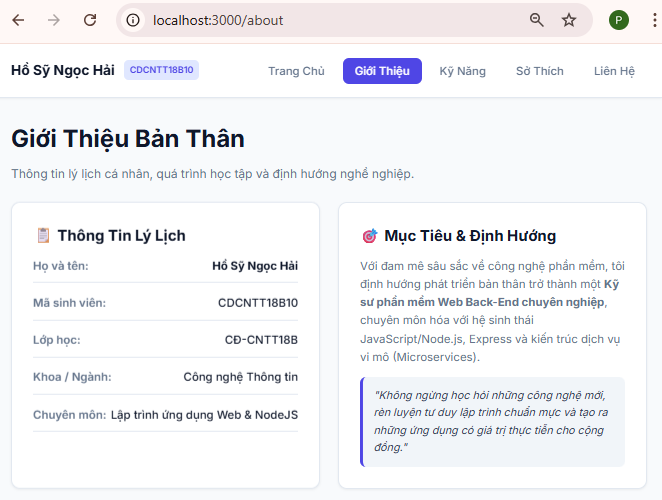
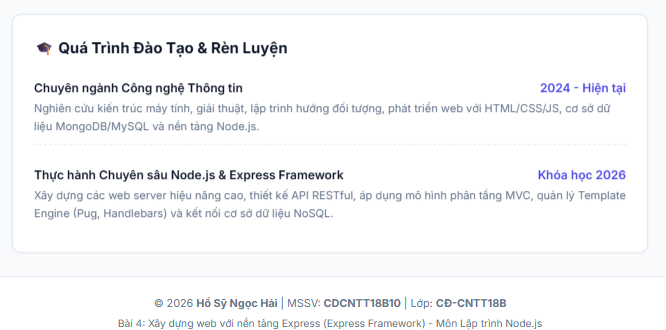
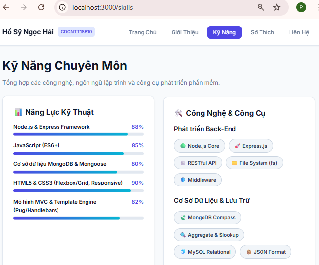
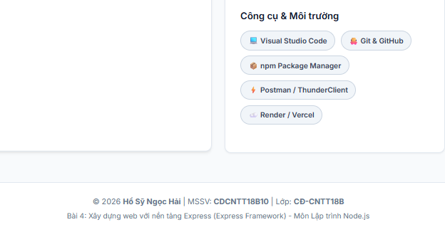
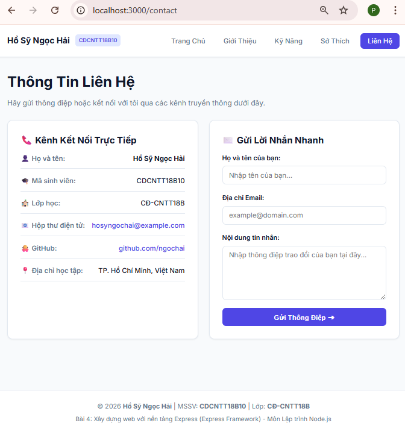

# BÀI TẬP 01: XÂY DỰNG WEBSITE GIỚI THIỆU CÁ NHÂN (EXPRESS FRAMEWORK)

## 1. Thông Tin Sinh Viên
- **Họ và tên:** Hồ Sỹ Ngọc Hải
- **Mã sinh viên:** CDCNTT18B10
- **Lớp:** CĐ-CNTT18B
- **Môn học:** Lập trình Node.js
- **Bài học:** Bài 4 — Xây dựng web với nền tảng Express (Express Framework)
- **Điểm tối đa:** 10.0 điểm

---

## 2. Mục Tiêu & Yêu Cầu Bài Thực Hành
Xây dựng một website cá nhân hoàn chỉnh bằng nền tảng Node.js và Express Framework đáp ứng đầy đủ các tiêu chuẩn kỹ thuật:
1. **Khởi tạo dự án:** Cấu hình `package.json`, cài đặt và sử dụng framework `express`.
2. **Hệ thống Route:**
   - `/`: Trang chủ (Home) - Giới thiệu tổng quan cá nhân và thông điệp chào mừng.
   - `/about`: Giới thiệu bản thân (About) - Thông tin lý lịch, mục tiêu nghề nghiệp và quá trình đào tạo.
   - `/skills`: Kỹ năng chuyên môn (Skills) - Biểu đồ năng lực kỹ thuật và danh mục công nghệ Back-end/Front-end/Database.
   - `/hobbies`: Sở thích cá nhân (Hobbies) - Các hoạt động ngoại khóa, thể thao, âm nhạc và giải trí.
   - `/contact`: Thông tin liên hệ (Contact) - Danh thiếp kết nối và biểu mẫu gửi lời nhắn trực tuyến.
3. **Giao diện HTML/CSS:** Thiết kế hiện đại, responsive, thẩm mỹ cao với thanh menu điều hướng (Navbar) liên kết xuyên suốt các trang.
4. **Xử lý 404 (Not Found):** Middleware bắt toàn bộ các đường dẫn không tồn tại và điều hướng sang trang `404.html` thân thiện kèm nút quay lại trang chủ.
5. **Hiển thị đường link Terminal:** Máy chủ tự động in banner và đường link trang chủ trực tiếp trên Terminal để người dùng dễ dàng `Ctrl + Click` mở trình duyệt.
6. **Khảo sát dịch vụ Hosting:** Nghiên cứu so sánh ít nhất 3 dịch vụ hosting miễn phí hỗ trợ Node.js, lựa chọn giải pháp tối ưu và hướng dẫn triển khai thực tế.

---

## 3. Cấu Trúc Thư Mục Dự Án
```text
Bt01/
├── image/                # Thư mục lưu trữ hình ảnh minh họa bài tập
│   ├── anh1.png          # Ảnh Terminal khởi chạy máy chủ Express
│   ├── anh2.png          # Ảnh Giao diện Trang chủ (Phần trên - Banner & Giới thiệu)
│   ├── anh3.png          # Ảnh Giao diện Trang chủ (Phần dưới - Thẻ liên kết nhanh & Footer)
│   ├── anh4.png          # Ảnh Giao diện Trang Giới thiệu (/about - Thông tin lý lịch & Mục tiêu)
│   ├── anh5.png          # Ảnh Giao diện Trang Giới thiệu (/about - Quá trình đào tạo & rèn luyện)
│   ├── anh6.png          # Ảnh Giao diện Trang Kỹ năng (/skills - Năng lực kỹ thuật & Công nghệ)
│   ├── anh7.png          # Ảnh Giao diện Trang Kỹ năng (/skills - Công cụ phát triển & Footer)
│   └── anh8.png          # Ảnh Giao diện Trang Liên hệ (/contact - Danh thiếp kết nối & Form nhắn tin)
├── node_modules/         # Thư viện Express và các phụ thuộc
├── public/               # Tệp tĩnh công khai được phục vụ qua express.static
│   └── css/
│       └── style.css     # CSS thiết kế giao diện hiện đại, responsive, components
├── views/                # Thư mục chứa các trang giao diện HTML
│   ├── index.html        # [Route /] Trang chủ giới thiệu
│   ├── about.html        # [Route /about] Trang thông tin cá nhân chi tiết
│   ├── skills.html       # [Route /skills] Trang kỹ năng và công nghệ
│   ├── hobbies.html      # [Route /hobbies] Trang sở thích và hoạt động
│   ├── contact.html      # [Route /contact] Trang thông tin liên hệ và form nhắn tin
│   └── 404.html          # Trang thông báo lỗi 404 khi sai đường dẫn
├── server.js             # Máy chủ Express định nghĩa các route và middleware
├── package.json          # Cấu hình dự án và dependencies
├── package-lock.json     # Khóa phiên bản thư viện chính xác
└── README.md             # Báo cáo thực hành chi tiết và khảo sát Hosting
```

---

## 4. Hướng Dẫn Cài Đặt & Chạy Website

### Bước 1: Mở Terminal trong Visual Studio Code
Mở thư mục dự án `D:\CĐ-CNTT18B\NODEJS` trong Visual Studio Code và mở Terminal tích hợp (`Ctrl + \``).

### Bước 2: Di chuyển vào thư mục bài tập Bt01
```powershell
cd Bai04\Bt01
```

### Bước 3: Cài đặt thư viện Express (nếu chưa cài đặt)
```powershell
npm install
```

### Bước 4: Khởi động Web Server
```powershell
node server.js
```

---

## 5. Kết Quả Hiển Thị Chi Tiết Trên Terminal

Khi thực thi lệnh `node server.js`, Terminal hiển thị banner thông tin sinh viên cùng đường link trang chủ truy cập trực tiếp:

```text
PS D:\CĐ-CNTT18B\NODEJS\Bai04\Bt01> node server.js

╔══════════════════════════════════════════════════════════════════════╗
║           BÀI TẬP 01: WEBSITE GIỚI THIỆU CÁ NHÂN (EXPRESS)           ║
║  Sinh viên: Hồ Sỹ Ngọc Hải  │  MSSV: CDCNTT18B10  │  Lớp: CĐ-CNTT18B  ║
╚══════════════════════════════════════════════════════════════════════╝

✔ Web Server đang chạy tại: http://localhost:3000
▶ Truy cập Trang chủ: http://localhost:3000/
```

---

## 6. Hình Ảnh Minh Họa Kết Quả Thực Tế

### 6.1. Khởi động Web Server trên Terminal
Terminal hiển thị đầy đủ Banner sinh viên **Hồ Sỹ Ngọc Hải (CDCNTT18B10)** cùng đường link mở Trang chủ:



---

### 6.2. Giao diện Trang Chủ (`/`)
Trang chủ gồm thanh điều hướng Navbar gắn huy hiệu MSSV, Hero Banner chào mừng và các lối tắt nhanh:



*Phần dưới của Trang chủ với các thẻ liên kết nhanh và Footer sinh viên:*



---

### 6.3. Giao diện Trang Giới Thiệu Bản Thân (`/about`)
Hiển thị danh mục Thông tin lý lịch, Định hướng nghề nghiệp phát triển Back-End:



*Chi tiết Quá trình đào tạo & rèn luyện chuyên sâu Node.js:*



---

### 6.4. Giao diện Trang Kỹ Năng Chuyên Môn (`/skills`)
Bao gồm thanh đo năng lực kỹ thuật và danh mục công cụ Back-End / Database:



*Danh mục Công cụ & Môi trường phát triển phần mềm:*



---

### 6.5. Giao diện Trang Liên Hệ (`/contact`)
Bao gồm kênh kết nối trực tiếp (Email, GitHub, Địa chỉ) và biểu mẫu gửi thông điệp trực tuyến:



---

## 7. Chi Tiết Các Route & Chức Năng Giao Diện

| STT | Tuyến Đường (Route) | Phương Thức | Tập Tin Giao Diện | Mô Tả Chức Năng |
| :-: | :--- | :-: | :--- | :--- |
| **1** | `/` | `GET` | `views/index.html` | Trang chủ hiển thị Hero Banner chào mừng, tóm tắt bản thân và các lối tắt khám phá. |
| **2** | `/about` | `GET` | `views/about.html` | Giới thiệu họ tên (Hồ Sỹ Ngọc Hải), MSSV (CDCNTT18B10), lớp (CĐ-CNTT18B), mục tiêu nghề nghiệp và lộ trình đào tạo. |
| **3** | `/skills` | `GET` | `views/skills.html` | Trình bày thanh phần trăm năng lực kỹ thuật và danh mục các công nghệ (NodeJS, Express, MongoDB, Git). |
| **4** | `/hobbies` | `GET` | `views/hobbies.html` | Lưới thẻ (Grid Cards) giới thiệu các sở thích cá nhân: lập trình, thể thao, âm nhạc, đọc sách, du lịch. |
| **5** | `/contact` | `GET` | `views/contact.html` | Cung cấp thông tin email, GitHub và biểu mẫu liên hệ trực tiếp cho người dùng. |
| **6** | `*` (Mặc định) | `USE` | `views/404.html` | Middleware bắt lỗi đường dẫn sai, trả về HTTP Status `404 Not Found` kèm nút quay về trang chủ. |

---

## 8. Khảo Sát Các Dịch Vụ Hosting Miễn Phí Hỗ Trợ Node.js

Nhằm đáp ứng yêu cầu triển khai website Node.js/Express lên môi trường Internet thực tế, dưới đây là bảng khảo sát chi tiết 3 dịch vụ hosting miễn phí phổ biến hiện nay:

### 8.1. Bảng So Sánh Chi Tiết 3 Dịch Vụ Hosting

| Tiêu Chí Đánh Giá | 1. Render (render.com) | 2. Vercel (vercel.com) | 3. Glitch (glitch.com) |
| :--- | :--- | :--- | :--- |
| **Loại hình kiến trúc** | Cloud PaaS (Web Services) | Serverless / Edge Platform | Online Container Platform |
| **Hỗ trợ Express.js** | **Rất tốt** (Chạy máy chủ Node.js truyền thống `app.listen` không cần sửa code). | **Khá** (Cần chuyển cấu hình Express thành Serverless Function qua `vercel.json`). | **Rất tốt** (Hỗ trợ container Node.js chạy code tức thời, có trong bài giảng). |
| **Cấu hình phần cứng Free** | 512 MB RAM, 0.1 vCPU | 100 GB Băng thông/tháng, Edge Functions | 512 MB RAM, 4,000 giờ máy chủ/tháng |
| **Chứng chỉ HTTPS / SSL** | Tự động miễn phí | Tự động miễn phí | Tự động miễn phí |
| **Tên miền miễn phí** | `*.onrender.com` | `*.vercel.app` | `*.glitch.me` |
| **Cơ chế triển khai (Deploy)** | Tự động đồng bộ từ GitHub Repository khi commit/push | Tự động qua GitHub, GitLab hoặc CLI | Sửa code trực tiếp trên web hoặc import từ GitHub |
| **Điểm hạn chế gói Free** | Ứng dụng sẽ "ngủ" sau 15 phút không có lượt truy cập (mất ~40s khởi động lại khi có request). | Cần hiểu cơ chế Serverless; không phù hợp các ứng dụng duy trì kết nối WebSocket lâu dài. | Tài nguyên giới hạn; ứng dụng ngủ sau 5 phút không có tương tác. |
| **Mức độ phù hợp** | ⭐⭐⭐⭐⭐ **(Tối ưu nhất cho Express)** | ⭐⭐⭐⭐ (Tối ưu cho NextJS/React) | ⭐⭐⭐⭐ (Rất tốt cho thực hành nhanh) |

---

### 8.2. Lựa Chọn Dịch Vụ Triển Khai: Render (render.com)

**Lý do lựa chọn:**
1. **Tương thích hoàn hảo với mã nguồn Express:** Dự án đã thiết lập sẵn biến môi trường `const PORT = process.env.PORT || 3000;`, Render sẽ tự động cấp phát cổng và khởi động mà không cần can thiệp cấu hình.
2. **Tự động hóa CI/CD:** Kết nối trực tiếp tài khoản GitHub, mỗi khi đẩy code mới lên branch `main`, Render tự động build và deploy phiên bản mới.
3. **Tên miền HTTPS chuyên nghiệp:** Cung cấp URL dạng `https://hosyngochai-portfolio.onrender.com` có chứng chỉ bảo mật SSL miễn phí.

---

### 8.3. Hướng Dẫn Các Bước Triển Khai Website Lên Render

#### Bước 1: Đẩy mã nguồn dự án lên GitHub
1. Khởi tạo Git repository trong thư mục `Bai04\Bt01`:
   ```powershell
   git init
   git add .
   git commit -m "Khoi tao website ca nhan Express - Ho Sy Ngoc Hải"
   ```
2. Tạo một Repository mới trên GitHub cá nhân (ví dụ: `nodejs-portfolio-bt01`).
3. Đẩy mã nguồn lên GitHub:
   ```powershell
   git remote add origin https://github.com/<tai-khoan-github>/nodejs-portfolio-bt01.git
   git branch -M main
   git push -u origin main
   ```

#### Bước 2: Đăng ký & Kết nối Render
1. Truy cập trang chủ [https://render.com](https://render.com) và đăng ký tài khoản (chọn đăng nhập bằng tài khoản GitHub).
2. Tại bảng điều khiển Dashboard, bấm nút **New +** và chọn **Web Service**.
3. Chọn tùy chọn **Build and deploy from a Git repository**.
4. Tìm và bấm **Connect** với kho chứa `nodejs-portfolio-bt01` vừa tạo ở Bước 1.

#### Bước 3: Thiết lập thông số cấu hình Web Service
Điền các thông số cơ bản như sau:
- **Name:** `hosyngochai-portfolio` (hoặc tên tùy chọn).
- **Region:** `Singapore` (để tối ưu tốc độ truy cập từ Việt Nam).
- **Branch:** `main`.
- **Runtime:** `Node`.
- **Build Command:** `npm install`.
- **Start Command:** `node server.js`.
- **Instance Type:** Chọn gói **Free ($0/tháng)**.

#### Bước 4: Hoàn tất & Kiểm tra thành quả
1. Bấm nút **Create Web Service**.
2. Render sẽ tự động tải mã nguồn, cài đặt gói thư viện Express và khởi chạy `node server.js`.
3. Sau khoảng 1-2 phút, Render thông báo trạng thái `Live` màu xanh lá cây kèm đường link công khai:
   ```text
   https://hosyngochai-portfolio.onrender.com
   ```
4. Mở trình duyệt và truy cập đường link để trải nghiệm website cá nhân trực tuyến từ mọi thiết bị (máy tính, điện thoại, máy tính bảng).
